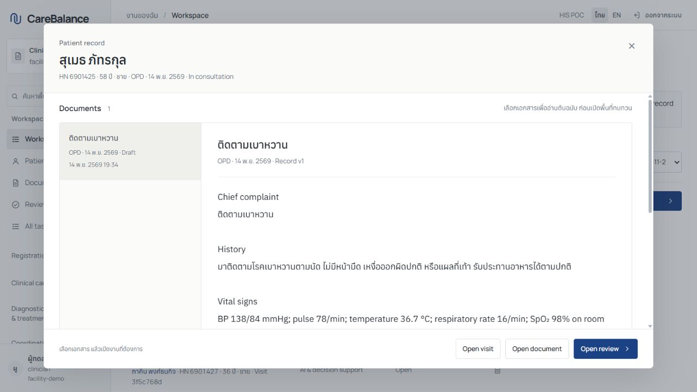
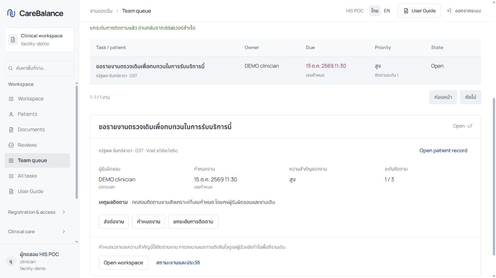
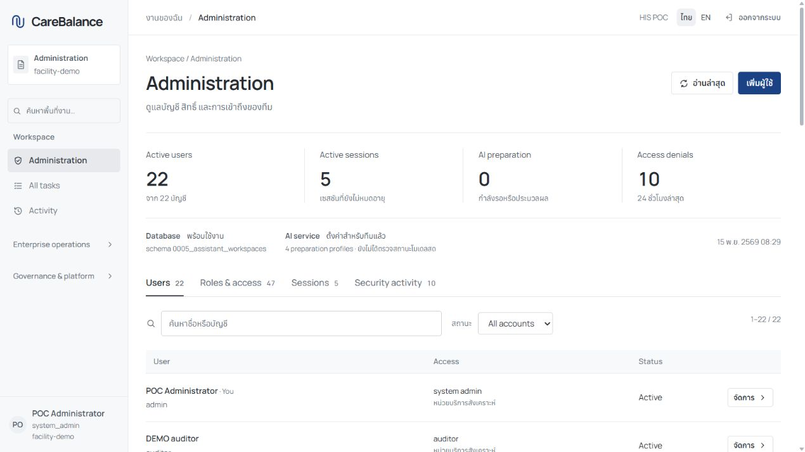
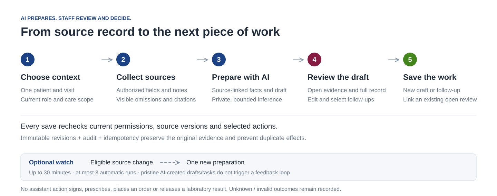
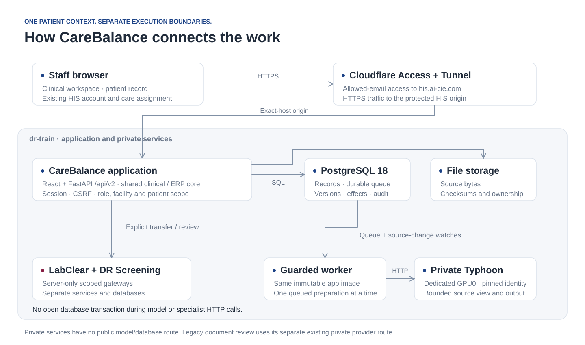
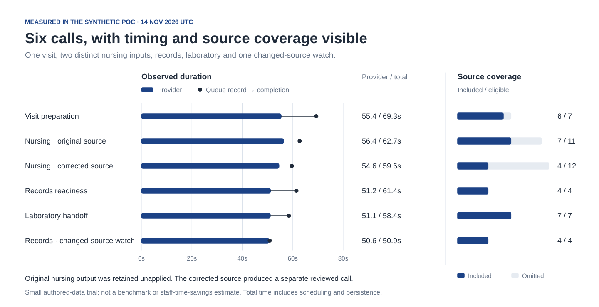

<p align="center">
  
</p>

<h1 align="center">Hospital workflows, prepared with AI</h1>

<p align="center">
  Patient records, staff work and source-linked preparation in one clinical workspace.<br />
  AI prepares facts and drafts. People review the evidence and decide what to save.
</p>

<p align="center">
  <a href="https://his.ai-cie.com">Open the protected POC</a> ·
  <a href="START_HERE.md">เริ่มใช้งานภาษาไทย</a> ·
  <a href="https://his.ai-cie.com/guide">User Guide</a> ·
  <a href="docs/RELEASE_AI_WORKSPACE.md">Release and evidence</a> ·
  <a href="docs/ARCHITECTURE.md">Architecture</a>
</p>

CareBalance is a hospital information and ERP development prototype built with
**React, FastAPI and PostgreSQL 18**. A shared patient and encounter context
connects registration, clinical documentation, nursing, diagnostics, follow-up
work and financial operations. The workspace supports Thai records with English
navigation and headings.

The protected POC runs on **dr-train behind Cloudflare Access**. Its four AI
preparation profiles use a dedicated, pinned Typhoon service. Local development
starts with the explicit mock provider; live inference requires separate
synthetic-only configuration. All demonstrated patient data are fictional.



## Try CareBalance

The current deployed milestone adds three connected workflows:

- **Source evidence:** read the captured original revision, exact field or quote,
  selected passages and disclosed omissions before using a preparation.
- **[Team queue](https://his.ai-cie.com/team-queue):** claim work, hand it to an
  eligible colleague with a reason, set an operational due date and follow an
  overdue task without creating another obligation.
- **Admin AI operations:** inspect persisted execution/review state, filters,
  timing, usage and unknown costs without opening patient charts or starting AI.

Four authored synthetic production application cases passed the new source
selection and human-review checks. Final protected-browser AI/Admin acceptance
is still pending normal Access renewal in the test session. Read the
[dated milestone report](docs/RELEASE_AI_TEAM_OPERATIONS_20261115.md),
[exact API examples](evidence/ai-team-20261115/api-acceptance.json) and
[task manual](docs/AI_TEAM_OPERATIONS.md) for the evidence boundary.



**Protected demo:** open [his.ai-cie.com](https://his.ai-cie.com), verify an allowed
email through Cloudflare Access, then use the existing **test01** account with
the password provided privately by the owner. The account has a limited care
assignment covering the original demonstration patient and six authored
fictional patients. Credentials are not distributed in this repository.

**Start locally:** use Python 3.12+ and Docker Desktop with its Linux engine
running. From the repository root:

```powershell
python scripts/dev.py init
python scripts/dev.py config
python scripts/dev.py up
```

Open [127.0.0.1:8000/login](http://127.0.0.1:8000/login). `init` creates a private
`.env`; read `HIS_SEED_PASSWORD` locally and use a seeded account such as
`registration` or `clinician`. The first `up` explicitly migrates and seeds
synthetic records. For later starts, use `python scripts/dev.py start`, which
does not seed. `stop` retains the data volumes.

See [START_HERE.md](START_HERE.md) for the native PostgreSQL alternative, account
workflow and configuration. Source publication and deployment are separate:
**a Git push does not update the running application**.

## Learn the workflows

The **[in-app User Guide](https://his.ai-cie.com/guide)** organizes 16 task-based
chapters and 38 domain references. It includes 11 synthetic screenshots with 10
step-by-step explanatory walkthroughs, searchable instructions, image zoom and
mobile navigation. Playback starts only when selected; reduced-motion readers
can use manual steps and the complete text transcript. Static help is available
from sign-in and never submits a clinical or AI command.

See the [guide release](docs/RELEASE_USER_GUIDE.md) for reading/browser evidence
and [content provenance](docs/USER_GUIDE_CONTENT.md) for source and workflow limits.

## Administration

Open **[Administration](https://his.ai-cie.com/admin)** with the privately
provisioned administrator account after Cloudflare Access. Normal login and
desktop/mobile reading flows passed on the protected POC; see the
[Admin release](docs/ADMIN_RELEASE_20261115.md) for exact acceptance limits.



The console brings together user search and status, persisted role memberships,
session review and revocation, security events, and an aggregate assistant-work
overview. AI counts describe persisted queue, execution, review and watch state.
Provider configuration is shown as configuration, not a live model-health test;
the overview does not read clinical bodies or request inference.

Access remains server-enforced. The initial administrator role does not include
clinical signing, chart-content access or host/platform operations. See
[Administration operations](docs/ADMIN_OPERATIONS.md) for permission boundaries,
versioned account actions and explicit private provisioning. Credentials remain
outside the repository.

## Prepare the work, keep the evidence

Select a patient visit and an available preparation profile. CareBalance collects
only the sources allowed by the current role, facility and care assignment. The
result presents facts, citations, an editable draft where applicable, and
permitted follow-up actions. Omissions remain visible so staff can open the full
patient record before using the preparation.



| Preparation profile | Sources available to that profile | Work a person can choose to save |
| --- | --- | --- |
| **Visit preparation** | Permitted notes, released laboratory values when authorized, and scoped tasks | A visit draft and a new or existing document-review task |
| **Nursing handover** | Permitted notes, nursing records and scoped tasks; the existing nurse role has no laboratory access | A handover draft and nursing follow-up |
| **Records readiness** | Patient and visit fields, document titles, status, versions and hashes; no document bodies | A metadata-review follow-up task |
| **Laboratory handoff** | Released or corrected values, units, reference ranges, recorded flags and review tasks | A new or existing laboratory-review task |

Saving rechecks permissions, source versions and the selected actions. Human
edits create a new immutable revision. Audit and idempotency bind the saved
effects, including when a command is replayed. An opt-in watch can follow source
changes for up to 30 minutes with at most three automatic preparations; opening
pages or reading evidence does not request inference.

**Operations starts with 2D lists.** An optional 3D view opens the same scoped
work from an illustrative hospital layout. It does not represent actual staff
locations or a hospital building. The [user journey](docs/USER_JOURNEY_TH.md)
describes the full record, draft, source-change and follow-up flows.

## Connected clinical and operational work

The local functional baseline spans **38 domains and 10 cross-module journeys**.
Each domain retains its own forms and state transitions while sharing identity,
patient context, evidence and transaction controls.

| Area | Prototype scope |
| --- | --- |
| Patient access | Registration, identifiers, appointments, queues, encounters, beds and discharge follow-up |
| Clinical care | Orders, nursing handover, medication workflows, clinical documents, laboratory results, imaging and referrals |
| Finance and supply | Charges, invoices, synthetic claims, receipts, reviewed refunds, procurement, lots and stock movements |
| Hospital operations | Staff references, assets, maintenance, support services, quality incidents, reporting and integration records |
| Patient portal | Published records and requests scoped to one server-linked patient |

**LabClear** opens a released HIS result in a separate, scoped review workspace.
An explicit transfer and human confirmation preserve the original HIS values.
**CareBalance DR Screening** is a separate derivative of the original DR project;
its protected acceptance covers authored-image context, quality confirmation and
an unsigned manual draft/reload subset. Those specialist checks do not establish
DR inference or clinical accuracy. See the [integration checkpoint](docs/integrations/VALIDATION_CHECKPOINT_20261114.md).

## Architecture

The application serves the production frontend and `/api/v2` from one origin.
Server-side role, organization, facility and patient-scope checks govern reads
and writes. PostgreSQL owns records, versions, task effects and audit; file
storage retains source bytes and checksums. Startup does not create or reset
data, and PostgreSQL is not silently replaced with SQLite.



The preparation worker runs separately with the same immutable application
image. Shared PostgreSQL admission limits legacy and preparation inference;
provider HTTP runs outside a database transaction. Model identity mismatches,
invalid outputs and unknown outcomes fail closed and retain their evidence.
There is no silent cloud or mock fallback. The existing document-completeness
route retains its own private provider configuration.

The diagram shows primary logical flows. Detailed interfaces, protocol and
deployment boundaries are in the [architecture guide](docs/ARCHITECTURE.md),
[assistant contract](docs/AI_DRIVEN_CONTRACT_V1.md) and
[deployment handoff](docs/DEPLOY_DR_TRAIN.md).

## What has been verified

The retained 14 November 2026 UTC AI acceptance used six authored-data application
calls across four profiles, including one corrected nursing source and one
changed-source watch. Five accepted decisions saved **two draft documents, two
new follow-up tasks and three links to existing tasks**. Actual identical-key
replay for nursing, records and laboratory produced no duplicate effects.



| Evidence boundary | Retained result | Source |
| --- | --- | --- |
| Local functional baseline | 38 domains at L2 and 10 journeys at L3 using synthetic PostgreSQL and rendered-browser evidence | [Domain coverage](DOMAIN_COVERAGE.md) · [Journey coverage](JOURNEY_COVERAGE.md) |
| Source-bound AI workflows | Six real application calls, five decisions, seven saved effects; nine actual role/scope checks | [Application acceptance](evidence/ai-driven-root-20261114/application-acceptance.json) |
| Protected browser | One visit: queue, source evidence, full omitted note, demonstration edit, apply and full reload; optional 3D navigation checked separately | [Browser acceptance](evidence/ai-driven-public-20261114/visit-browser-acceptance.json) · [3D check](evidence/ai-driven-public-20261114/optional-3d.json) |
| Administration extension | 38PostgreSQL,171mounted frontend and31unit checks; private account plus protected desktop/mobile reading subset | [Admin release](docs/ADMIN_RELEASE_20261115.md) |
| Runtime and preservation | Guard process and identity pins observed; HIS, LabClear and DR ready; old rows/files preserved with intentional HIS additions recorded | [Runtime readback](evidence/ai-driven-root-20261114/assistant-runtime-readback.json) · [Deployment](evidence/ai-driven-root-20261114/deployment-readback.json) |

These are bounded synthetic integration results. The other staff profiles were
tested through normal authenticated production APIs, rather than separate
public-browser role journeys. Visit and nursing inputs omitted eligible records;
drafts largely copied included short notes and some facts selected titles or
dates of birth. The chart is **not a benchmark, latency SLA or staff-time-savings
estimate**. Monetary cost remains unmeasured/null. Clinical effectiveness,
all-domain real AI, DR/CAD model acceptance and host-reboot acceptance remain
unestablished. The [release report](docs/RELEASE_AI_WORKSPACE.md) preserves the
exact scope, source identities, original attempts and limitations.

## Product direction

The next priorities are stronger **source-aware preparation**, **team ownership**
and **operational visibility**:

- Select clinically relevant permitted sources and show what changed since the
  previous review, with exact citations and visible omissions.
- Add a team inbox with claim, handoff, due-date and escalation workflows that
  preserve one accountable owner under concurrent updates.
- Extend administration and AI operations with evidence freshness and clearer
  distinctions between configured, permitted, running and qualified services.

These are proposed improvements beyond the implemented first Admin slice and
existing preparation workflows. Benefits are hypotheses to measure, not staff
time already saved. The [product review and roadmap](docs/PRODUCT_REVIEW_20261115.md)
maps priorities and acceptance criteria across all 38 domains; it does not
activate those features or expand permissions.

## Development

Use Python 3.12+, Node.js 24 and PostgreSQL 18 for native development. Install
the locked dependencies before running checks:

```powershell
python -m pip install -r requirements-backend.txt -r requirements-validation.txt
npm --prefix apps/web ci
npm --prefix apps/web run typecheck
npm --prefix apps/web test
npm --prefix apps/web run test:component
python scripts/check_fullsystem_package.py
```

The [validation report](VALIDATION_REPORT.md) documents PostgreSQL and real
browser execution, disposable test clusters and source-specific results. The
commands above are developer entrypoints, not a claim that every suite was rerun
for this documentation change. Keep `.env`, credentials, session material,
database files, backup contents and real patient data outside source control.

| Location | Purpose |
| --- | --- |
| [`apps/web/`](apps/web/) | React workspaces, typed client, forms and browser checks |
| [`backend/app/`](backend/app/) | Authentication, shared records, domain services and AI boundaries |
| [`backend/migrations/`](backend/migrations/) | Versioned PostgreSQL migrations |
| [`docs/integrations/contracts-0005/`](docs/integrations/contracts-0005/) | Current additive API/DDL reference; historical `contracts/v2` stays separate |
| [`docs/admin/`](docs/admin/) | Additive administration API reference and operator contract |
| [`spec/`](spec/) | Canonical scope, domain matrix and acceptance criteria |
| [`evidence/`](evidence/) | Dated execution records with explicit evidence limits |

[User journey](docs/USER_JOURNEY_TH.md) ·
[Operations](docs/OPERATIONS_FULLSYSTEM.md) ·
[Cloudflare setup](docs/CLOUDFLARE_SETUP_TH.md) ·
[Backlog](BACKLOG.md) · [Engineering handoff](CODEX_HANDOFF.md)

## Licensing and visual provenance

A repository-wide license has not yet been selected. Third-party permissions
and UI reference provenance are documented in
[LICENSE_NOTICES.md](apps/web/LICENSE_NOTICES.md) and
[TEMPLATE_PROVENANCE.json](apps/web/TEMPLATE_PROVENANCE.json).

The README diagrams and chart are authored for CareBalance, use its existing
palette, and load no external fonts or assets. Their editable generator, source
map and rendering checks are recorded in [README_VISUALS.md](docs/README_VISUALS.md).
