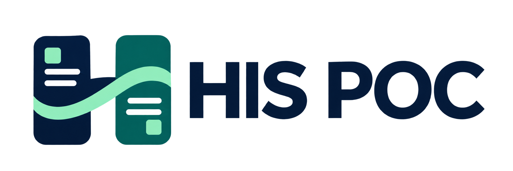
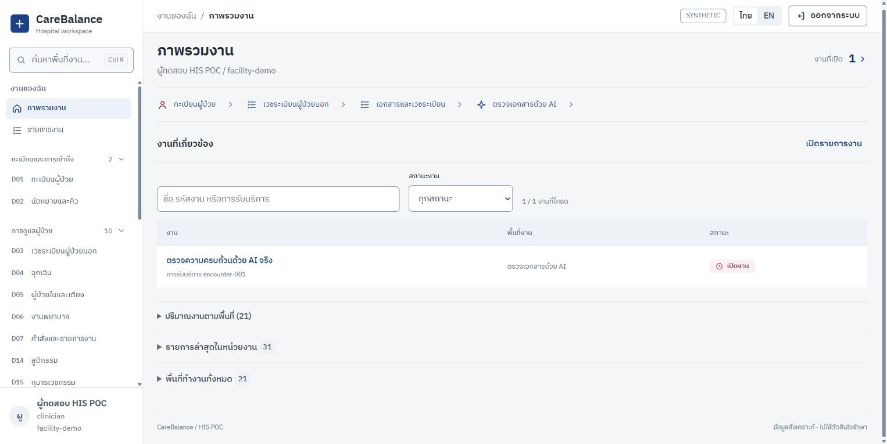
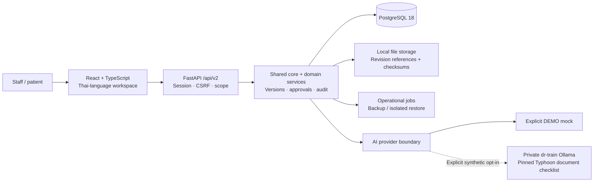

<p align="center">
  
</p>

<h1 align="center">Connected hospital workflows. Traceable records.</h1>

<p align="center">
  A hospital information and ERP development prototype with shared patient context,
  server-enforced permissions, and auditable transactions.
</p>

<p align="center">
  
  
  
  
</p>

<p align="center">
  <a href="START_HERE.md">เริ่มใช้งานภาษาไทย</a> ·
  <a href="docs/ARCHITECTURE.md">Architecture</a> ·
  <a href="DOMAIN_COVERAGE.md">Domain coverage</a> ·
  <a href="JOURNEY_COVERAGE.md">Journey coverage</a> ·
  <a href="VALIDATION_REPORT.md">Validation evidence</a>
</p>

## Open the protected POC

**[his.ai-cie.com](https://his.ai-cie.com)** now serves the redesigned application on dr-train behind Cloudflare Access. Use an allowed Access email, then sign in to HIS as **test01** with the password supplied privately by the owner. This limited synthetic account can work with patient-001 and the document/AI review flow.

The interface uses the owner's blue **#1C4286**, burgundy **#861C42** and green **#42861C** anchors: one searchable task register, shared record workspaces and source beside human review. No-slop-ui and Hallmark guidance informed the redesign; [design decisions and provenance](docs/design/TRIADIC_REDESIGN.md) describe what was actually used.



The real HTTPS flow passed document save → Typhoon findings → human edit v2 → approval → commit → reload. Server readback confirms one inference and one result, source/approval hash binding, **10.414 seconds**, **422 input / 136 output tokens**, and cost unmeasured. These are one synthetic integration observation, not clinical accuracy or a performance guarantee. See [public acceptance](evidence/triadic-release/public-final/browser-acceptance.json) and the [deployment runbook](docs/DEPLOY_DR_TRAIN.md).

Frontend checks passed **25 unit / 69 component tests**, audit, typecheck and build. Actual local desktop/tablet/mobile confirmation passed 13 observations. Public app source and all 21 built assets match the reviewed candidate. The earlier full-system baseline below retains its original scope.

## Overview

HIS POC explores how clinical, administrative, and financial teams can work with the same patient, encounter, document, and task records. It combines a Thai-language React workspace with a FastAPI modular monolith and PostgreSQL persistence. Local accounts and permissions are verified by the server; changing a label or selection in the browser does not grant access.

The development scope covers **38 domains** and **10 cross-module journeys**, from registration and laboratory results to dispensing, stock movements, claims, refunds, and patient follow-up. Each domain has its own forms and state transitions, while identity, clinical context, evidence, and audit records remain shared.

**Release baseline: v0.3.0 locally validated development prototype, now with a separately verified protected deployment.** All **38 domains at L2** and **10 journeys at L3** have executed local synthetic PostgreSQL and rendered-browser evidence. The [validation report](VALIDATION_REPORT.md) records exact commands, source/runtime hashes, retained failures, and the boundary between local workflow acceptance and external or clinical verification.

## What the prototype includes

| Area | Local workflow scope |
|---|---|
| Patient and encounter management | Registration, identifiers, appointments, queues, outpatient visits, admissions, beds, transfers, and discharge follow-up |
| Clinical workspaces | Orders, nursing handover, dispensing and administration records, laboratory results and corrections, imaging files and reports, specialist documentation, and referrals |
| Patient portal | Server-linked patient access to published records and appointment or follow-up requests |
| Finance and supply chain | Versioned prices, charges, invoices, synthetic claims and remittance, receipts, independently reviewed refunds, costs, procurement, lots, and stock movements |
| Hospital operations | Staff references, assets, maintenance, support services, quality incidents, reporting, integration records, and analytical snapshots |
| Shared controls | Sessions, scope and permission checks, immutable document revisions, version-bound approvals, audit records, idempotent mutations, and isolated backup/restore |
| AI review | Explicit DEMO mock by default; optional pinned Typhoon inference for synthetic document completeness, with human editing, review, approval, and commit |

The [domain matrix](spec/DOMAIN_IMPLEMENTATION_MATRIX.md) defines the minimum required behavior. The [coverage files](DOMAIN_COVERAGE.json) describe implementation and verification separately.

## Architecture



The application serves the production frontend and API from one origin. SQLAlchemy models and Alembic migrations own the database schema. PostgreSQL is the primary database; there is no automatic SQLite fallback. Historical SQLite and v1 demo code remain isolated for regression and import work and are not mounted in the default application.

Mutations check current server identity, permissions, scope, entity version, and allowed state before writing. Domain records, audit entries, and idempotency outcomes share transaction boundaries. Posted financial entries and stock movements use reversals or returns rather than overwriting the original posting. See [architecture](docs/ARCHITECTURE.md) and [workflow contracts](docs/WORKFLOWS.md) for the detailed rules.

## Quick start with Docker Desktop

**Prerequisites:** Python 3.12+, Docker Desktop running its Linux engine, and an available local port 8000. The image build installs the locked application dependencies and builds the frontend.

From the repository root:

```powershell
python scripts/dev.py init
python scripts/dev.py config
python scripts/dev.py up
```

`init` creates a private `.env` with random development passwords. `config` validates Compose without printing secrets. The first `up` explicitly starts PostgreSQL, applies migrations, seeds synthetic records, and starts the application.

Open **[http://127.0.0.1:8000/login](http://127.0.0.1:8000/login)**. Use a seeded account such as `registration`, `clinician`, `nurse`, `laboratory`, `imaging`, `pharmacist`, `billing`, `finance`, `inventory`, `quality`, `system_admin`, `auditor`, or `patient`. Read `HIS_SEED_PASSWORD` privately from your local `.env`; there is no bundled shared password.

Start with `registration` to create a patient and encounter. An administrator must assign the new patient to the appropriate clinical user before that user can work with the record. Log out and sign in to change accounts; the server determines the resulting permissions.

For later sessions:

```powershell
python scripts/dev.py start
python scripts/dev.py status
python scripts/dev.py logs
python scripts/dev.py stop
```

`start` applies migrations and starts the application without seeding. `stop` retains the data volumes. Startup does not reset existing records. If the Docker engine is unavailable, the launcher reports the failure; follow the native PostgreSQL path below or start Docker Desktop and retry.

### Native PostgreSQL alternative

Use a **dedicated development PostgreSQL 18 database**, Python 3.12+, and Node.js 24. Create an empty database before running the seed command.

```powershell
python -m venv .venv
.\.venv\Scripts\Activate.ps1
python -m pip install -r requirements-backend.txt
npm --prefix apps/web ci
npm --prefix apps/web run build
python scripts/dev.py init
```

Set `DATABASE_URL`, `FILE_STORAGE_ROOT`, `BACKUP_ROOT`, and the local origin settings in your private `.env` using [.env.example](.env.example) as the configuration reference. Point the database URL only at the isolated development database, then run:

```powershell
python scripts/dev.py native-seed
python scripts/dev.py native-up
```

`native-seed` explicitly migrates and seeds. `native-up` migrates and starts the application without seeding. Backup and restore additionally require PostgreSQL client tools. See the [operations guide](docs/OPERATIONS_FULLSYSTEM.md) for configuration and restore into a separate target.

## Verification and acceptance

The local acceptance baseline below was executed on 13 November 2026 using synthetic data and the explicit mock AI profile. Subsequent real Typhoon checks are listed separately; they do not turn the baseline journeys into live-model evaluations.

| Evidence category | Executed local result |
|---|---|
| Windows Docker startup and repeat seed | PASS; PostgreSQL 18.6, 108 application tables |
| Core, clinical, ERP, operations and security workflows | 84 PostgreSQL tests PASS; another 10 legacy-import tests PASS |
| Same-origin HTTP smoke | 19 assertions PASS, including restart persistence |
| Frontend checks | 25 unit and 53 jsdom component tests PASS |
| TypeScript, production build and audit regression | PASS |
| Real Chromium acceptance | 10 journeys and 12 supplemental domain scenarios PASS |
| Browser recovery | 9 assertions PASS: conflict, scope isolation, audit, restart and UI restore |
| Real UI backup/isolated restore | 109 tables including Alembic, one file and eight exact browser records verified |
| Local L2/L3 target | 38/38 domains and 10/10 journeys PASS |
| Other external integrations and clinical effectiveness | NOT_RUN / NOT_CONNECTED |

### Optional real document completeness

A separately authorized private route has executed **Typhoon 2.1 Gemma 3 12B** through Ollama 0.12.6 on dr-train, with V100 hardware observed. The exact model is `hf.co/scb10x/typhoon2.1-gemma3-12b-gguf:Q4_K_M`, pinned by its installed Ollama manifest digest. It checks five documentation sections in authored synthetic Thai text and cites source excerpts. It does not evaluate clinical correctness.

| Additional evidence | Executed result |
|---|---|
| Real provider cases | Three authored Thai cases PASS: complete, missing plan, missing author |
| Real rendered workflow | 7 browser assertions PASS: findings, source quotes, human edit/approve/commit, provenance, and reload |
| Read-only browser verification | 2 assertions PASS; existing run/result read back without new inference |
| Sample browser inference | 11.205 seconds; 408 input / 141 output tokens reported by Ollama; measured cost `null` |
| New orchestration regressions | 17 PostgreSQL tests PASS with deterministic provider doubles; these are not 17 real model calls |
| Updated frontend | 60 component tests PASS; the baseline above retains its own 25 unit / 53 component results |

Use the [private AI setup guide](docs/DR_TRAIN_AI.md) for opt-in configuration, identity pins, SSH forwarding, resource limits, evidence links, and the five-section review flow. **MedGemma 27B is installed but has not been inference-tested in this work.** No additional model download is needed for the verified document-completeness scope.

The [validation report](VALIDATION_REPORT.md) and linked execution logs are the source of truth for subsequent reruns and corrections. [Domain coverage](DOMAIN_COVERAGE.json) and [journey coverage](JOURNEY_COVERAGE.json) retain per-item status and evidence references.

To reproduce the PostgreSQL and frontend suites in a prepared environment:

```powershell
python -m pip install -r requirements-backend.txt -r requirements-validation.txt
npm --prefix apps/web ci
python scripts/validate_fullsystem.py --pg-bin "C:\path\to\PostgreSQL\18\bin" --include-frontend
```

The PostgreSQL wrapper creates disposable synthetic test clusters. Browser scripts run separately against an already running isolated app and require an installed Playwright Chromium browser plus private seed credentials in the process environment. Consult [START_HERE.md](START_HERE.md), [VALIDATION_REPORT.md](VALIDATION_REPORT.md), and the scripts under [`apps/web/scripts`](apps/web/scripts) before running them.

## Repository guide

| Path | Purpose |
|---|---|
| [`apps/web/`](apps/web/) | React workspace, typed client, domain forms, and browser checks |
| [`backend/app/`](backend/app/) | Authentication, shared entities, API, and domain services |
| [`backend/migrations/`](backend/migrations/) | Versioned PostgreSQL migrations |
| [`contracts/v2/`](contracts/v2/) | Exported API schemas and database references |
| [`docs/DATA_DICTIONARY.csv`](docs/DATA_DICTIONARY.csv) | Exported data dictionary |
| [`scripts/`](scripts/) | Development launcher, validation, contracts, import, and operational tools |
| [`data/`](data/) | Synthetic data manifests and provenance |
| [`spec/`](spec/) | Canonical system scope, domain matrix, and acceptance plan |
| [`evidence/fullsystem/`](evidence/fullsystem/) | Executed checks, source evidence, and review records |
| [`CODEX_HANDOFF.md`](CODEX_HANDOFF.md) | Current technical handoff and remaining work |
| [`docs/DR_TRAIN_AI.md`](docs/DR_TRAIN_AI.md) | Optional private Typhoon setup, limits, and real-inference evidence |

## Development principles

Changes should extend the shared identity, patient, encounter, and transaction boundaries. Add domain-specific behavior and meaningful PostgreSQL regressions rather than parallel tables or generic placeholders. Keep implementation status, executed PASS/FAIL, mock behavior, and NOT_RUN checks distinct.

After API or model changes, regenerate contracts and check package consistency:

```powershell
python scripts/export_contracts_v2.py
python scripts/check_fullsystem_package.py
```

Follow [AGENTS.md](AGENTS.md), the [acceptance plan](spec/ACCEPTANCE_TEST_PLAN_TH.md), and the [backlog](BACKLOG.md). Include the relevant test commands, exit statuses, source references, and remaining gaps with each change.

## Data, AI, and deployment boundaries

This repository uses **synthetic development data**. Keep `.env`, database credentials, session material, local database files, backup contents, and real patient information out of commits, issues, screenshots, and logs.

AI defaults to an explicitly labeled **DEMO mock**. The optional `dr_train_ollama` profile requires explicit synthetic-only opt-in and exact engine/model identity pins. Its verified scope is document completeness. Unknown providers, missing configuration, unavailable connections, identity mismatches, and invalid output fail closed; there is no silent cloud or mock fallback. Manual image/report workflows and mock proposals are not clinical predictions.

Production deployment, hospital interfaces, payer certification, other live models/tasks, and clinical or product effectiveness remain separate work. Their status must be supported by their own evidence. The three real provider cases and one rendered real-model workflow establish a bounded integration check, not a benchmark or production/clinical readiness.

## Licensing and provenance

A repository-wide license has not yet been selected. Review the applicable permissions before redistributing project code. Third-party notices and UI reference provenance are recorded in [`apps/web/LICENSE_NOTICES.md`](apps/web/LICENSE_NOTICES.md) and [`apps/web/TEMPLATE_PROVENANCE.json`](apps/web/TEMPLATE_PROVENANCE.json). Referencing a library does not mean it is a runtime dependency or that its license covers the entire project.

## Deployment and updates

Cloudflare Access and the connector are active for the exact hostname. The app, its dedicated PostgreSQL database and file storage run on dr-train; Cloudflare carries HTTPS traffic and access checks. Existing shared Ollama remains private. The Windows database is preserved as a separate copy, with no bidirectional synchronization.

A push to main **does not automatically deploy**. Future updates require a verified source snapshot, backup, image build and app replacement as described in [DEPLOY_DR_TRAIN.md](docs/DEPLOY_DR_TRAIN.md). Keep credentials private. Historical preparation evidence and the previous palette remain under their dated reports.
