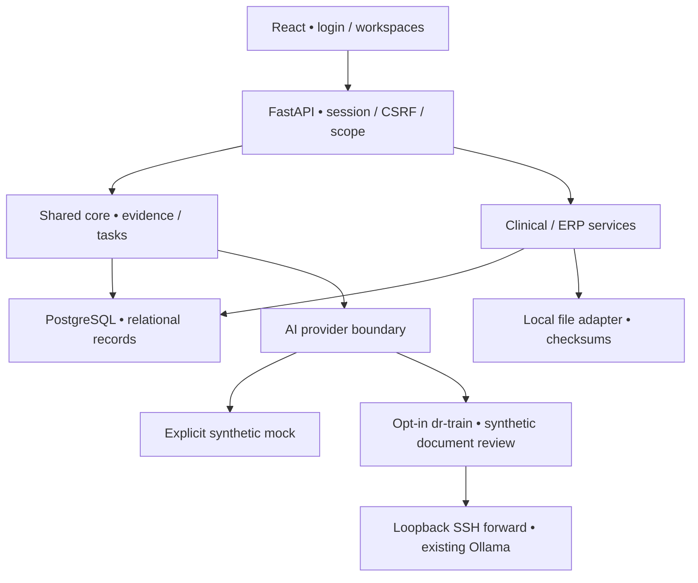

# Full-system architecture

## AI team operations boundary — schema0006

The deployed extension adds typed `task_coordination` metadata to the existing
Task obligation, profile-ranked exact passages and immutable source-snapshot
reads, plus metadata-only Admin monitoring. Operational ownership/date/priority/
escalation edits increment the physical coordination version without invalidating
unchanged semantic clinical evidence. Status/source/permission changes still
invalidate stale actions. Explicit prepare reuse checks input_hash; reads,
ownership edits and Admin monitoring do not request inference.

Source coverage discloses omitted/partial inputs. Snapshot text is historical
original evidence; exact quotes use Unicode code-point offsets, while typed
fields retain their exact source identity. Draft attribution still requires
human review. Claim/handoff never grants access to another actor's AI output.
Admin health/cost/freshness unknowns remain explicit rather than estimated.

Backend `1960a827` plus frontend `b860725` is deployed on schema0006; the final
overlay preserves all backend inputs. Six bounded synthetic application/model
cases and final protected native smoke passed. Final read-only preservation
audit v2 passed at 07:42:40.269671 UTC; source publication remains pending.
[Preservation scope](../evidence/ai-team-20261115/deployment-preservation.json).
None of these results establishes clinical effectiveness. See the [contract](AI_TEAM_OPERATIONS_CONTRACT.md),
[release](RELEASE_AI_TEAM_OPERATIONS_20261115.md) and
[current deployment handoff](../CODEX_HANDOFF.md). Sections below retain earlier
slices and their original schema/evidence.

## Static learning workspace

The /guide route lazily loads authored chapter/domain data and self-hosted exact
synthetic screenshots. Its only shell request is the ordinary session probe;
the guide is context-free and skips patient/encounter prefetch. An unauthenticated
HIS reader can use static help behind the existing Access gate. Role filters
organize lessons and grant no permission. Screenshot tours/zoom are local view
state, with explicit playback, reduced-motion support and keyboard access.
No backend router, schema, provider adapter, dependency or business workflow
changed. See [release](RELEASE_USER_GUIDE.md) and [media provenance](USER_GUIDE_MEDIA.json).

## Retained initial Administration boundary — schema0005

The /admin frontend uses existing sessions/CSRF and persisted D34.read plus
identity.admin authorization. Organization directory/session projections and
facility assistant aggregates exclude clinical bodies and credentials. Private
named-POC provisioning is explicit, transactional and idempotent; startup does
not provision accounts. That initial release stayed on schema0005; the current
extension above uses schema0006. Overview reads perform no provider
HTTP or model generation. See [operator contract](ADMIN_OPERATIONS.md),
[API subset](admin/README.md) and [release](ADMIN_RELEASE_20261115.md).

## Retained initial AI preparation workspace — schema0005

The retained initial AI release source286f391/image9afd established migration0005 and126 tables. The Admin release preserves this schema and AI boundary.
The four role-scoped preparation profiles use the existing session, CSRF, care
assignment and domain permissions. Durable assistant runs, revisions, decisions,
effects and bounded watches are additive; source documents remain immutable.
Normal API writes queue work. A separate guarded CLI worker uses the same image
and a private dedicated Typhoon GPU0 service; no database transaction spans the
model HTTP call. One PostgreSQL admission boundary covers legacy and assistant
inference. Unknown dispatch remains quarantined until audited terminal evidence.

The source-bound artifact is reviewed before ordinary draft/task effects apply
atomically with audit and idempotency. No assistant effect signs, prescribes,
orders or releases a result. Records preparation sends metadata only; the
existing nurse cannot gain laboratory access by selecting another profile.
The complete manifest remains server-side; the compact model view reports
omitted sources. Operations is2D first; optional lazy3D reads the same scoped
work and run states and never triggers generation. The foreground cron worker
and six real application calls passed bounded production acceptance; host reboot
is NOT_RUN. See the [contract](AI_DRIVEN_CONTRACT_V1.md),
[release guide](RELEASE_AI_WORKSPACE.md) and its dated evidence; current scope is recorded above and in GOAL.md.

## CareBalance specialist boundary

LabClear uses `integrations.py`, immutable connector bindings/attempts/exchanges
and additive migration0003. The HIS browser retains its own session/CSRF and
released-result context; a server-only signed request reaches a dedicated
loopback LabClear receiver/database. No browser cookie, OCR route, model call or
existing LabClear business account is forwarded. Reserve commands and close the
database transaction before HTTP; retain unknown outcomes and retry only the
original semantic command. Source values and HIS task completion remain separate
from confirmed review. Startup validates receiver DB identity/schema before
route registration. [Contract and evidence](integrations/VALIDATION_CHECKPOINT_20261114.md).

The separate DR derivative is deployed with a fixed immutable clinical workspace
and sealed source set with current verified HIS actor/capability. Its broad legacy
factory, workspace/admin/model routes and self-declared signer fallback are not
integration surfaces. Protected public acceptance covers authored-image context,
quality confirmation and an unsigned manual draft/reload subset. It does not
establish DR inference or clinical accuracy. Original DR source remains separate.
See [the exact release](RELEASE_REALISTIC_PATIENTS.md).

Current application: React/TypeScript/Vite → same-origin FastAPI `/api/v2` → SQLAlchemy PostgreSQL18. Domain routers share one identity/session, one patient/encounter core, one unit of work and one audit/operation boundary. SQLite/std-library server remains isolated historical regression; it is not mounted by the application. `/api/v1` default returns404. No new response shape is inserted under v1 routes.

## Ownership and transactions

`backend/app/models.py` owns organization/facility/user/session/patient/encounter/task/document/order/AI/audit/operation records. `models_clinical.py` and `models_erp.py` own their relational tables. Domain relationships point to shared IDs. JSONB is used for snapshots, model outputs, event details and analytics snapshots; identity, quantities, money and core relationships remain relational.

Core schema/interfaces are in `backend/INTERFACES.md`; generated reference DDL and OpenAPI are in `contracts/v2/`. Apply Alembic migrations, never generated reference SQL. Important subject relationships use DB foreign keys, domain services recheck ownership and expected versions. Readiness must verify schema version and DB connection; startup does not create or seed tables.

A successful mutation must complete its transaction before the success response. It revalidates current account/membership/session, scope, permission, entity state/version, and domain invariants. Operation identity is actor+idempotency key bound to canonical payload and operation. The same operation replays its stored response; different content conflicts. Domain writes and audit/operation records commit together. Stock, bed, slot and financial records use row/advisory locks and constraints where implemented; executed concurrency cases are listed in validation rather than inferred from locking code.

## Authentication and frontend state

Local development accounts are stored server-side with Argon2 password hashes. Opaque session token is stored in HttpOnly SameSite cookie; server stores token hash and expiry/revocation. CSRF token guards authenticated mutations. HTTPS configuration adds Secure; local loopback HTTP is explicit. Production OIDC/MFA remains outside local acceptance.

Frontend loads identity/permissions from `/auth/me`, clears record/context/draft state on session changes, and scopes clinical queries to selected patient/encounter. Response identities and versions bind display/action state. Mutation success updates its returned record before optional refresh. Definitive no-write conflicts clear pending; transport ambiguity retains operation key until matching read-back or replay confirms. A successful unrelated GET never confirms a commit. Skip-link focus does not modify route; deep links resolve through same-origin SPA serving.

## Documents and AI

New document revisions are immutable with canonical hash/version references. Attestation is an authenticated internal action, not an asserted legally qualified signature. Amendments preserve previous revisions. Proposals bind task, evidence revision and encounter version; edits increment proposal version and invalidate approval; commit rechecks evidence and current authorization. Failure/timeout/abstention create run records without synthetic success hidden behind them.

The default provider is a deterministic demo adapter with synthetic inputs. No live fallback exists. `config/` retains observed model/runtime metadata and defaults; application deployment is independent of inference placement. Unknown usage/cost stays null. DR/CAD interfaces/evaluators remain separate. Local manual image/report workflows are not live predictions.

## Files, integration and operations

File records bind checksum/MIME/authorized clinical owner; local bytes live in a configured directory. Backup must include PostgreSQL and file manifest, and restore verifies both in an isolated target. Integration module records synthetic inbox/outbox delivery/retry/acknowledgement as local, never external successful transmission without an endpoint.

Financial summaries retain gross receipts and refunds separately; net=gross-refunded. Outstanding uses invoice adjustments, payment allocations and explicit allocation releases. Posted amounts and stock movements are not overwritten by returns/reversals. Allocation/cost definitions and measured tests appear in WORKFLOWS and validation.

Canonical target is `spec/`; actual implementation and remaining gaps are `DOMAIN_COVERAGE.json`. This architecture does not itself certify every invariant or every domain as tested.

## Denial-audit concurrency and support visibility

SecurityEvent recording is synchronous database work dispatched through run_in_threadpool from the async HTTP middleware. Its actor foreign key can wait on another request's identity lock; the event loop must remain free to complete that request and commit. Domain write/audit/idempotency transactions remain unchanged. A live Uvicorn/PostgreSQL regression holds the real FK lock and verifies health responsiveness before releasing it, then checks the persisted denial event.

Entity-scoped audit reads for ERP support records require their domain permission, organization/facility scope and membership in the existing actor-visible rows policy. In particular, a nurse can inspect their own staff audit while quality users retain authorized staff oversight. Imaging file bytes require document content/export rights in addition to D11 record scope, and successful downloads create a bounded checksum audit event.

## Opt-in live document completeness

HIS_AI_PROVIDER=dr_train_ollama plus HIS_LIVE_SYNTHETIC_ENABLED=true selects the native Ollama adapter for document_review only. Startup/requests fail closed on missing settings, unknown providers, engine-version/model-manifest mismatch or unsupported tasks; no mock/cloud fallback. Registries describe observations; environment settings are the runtime authority. Source is untrusted data; output must match a fixed five-key JSON schema and each nonempty quote must occur verbatim in the referenced document. These controls do not validate clinical or semantic correctness.

The API commits an actor/key-bound InferenceRun reservation and started audit, then closes its database session before awaiting external inference. PostgreSQL advisory admission permits one active unexpired run across users/workers. Same-key pending requests receive202 without another call; conflicting payloads409. A lease derived from configured timeout plus60 seconds retains interrupted outcomes after expiry. The provider uses an absolute asyncio deadline around the whole HTTP pipeline, bounded context/output and pinned metadata. Transport cancellation does not establish remote-engine cancellation.

A fresh transaction rechecks session/account/permissions, patient/encounter/task domain and versions, document revision and evidence hashes before persisting a proposal. Stale, revoked, busy, malformed, abstained, failed and timeout outcomes remain recorded. Success writes proposal/version/audit/idempotency together. The frontend renders five typed findings and actual run provenance; only the human review/approval/commit flow writes a final result. Edits preserve the report and create a new action hash/version. Migration0002 adds nullable reservation/provenance columns and the actor+operation-key uniqueness constraint; historical rows remain intact.

## Observed protected server placement

The separately authorized synthetic POC is deployed on dr-train under /home/chaw/his-poc. Cloudflare Access and an exact-host JWT-required Tunnel route his.ai-cie.com to127.0.0.1:18080. The dedicated app uses an isolated PostgreSQL18.6 instance at127.0.0.1:15432 and persistent file/backup volumes. Existing Ollama stays on127.0.0.1:11434. No model/database public route exists. App/DB/connector restart unless stopped with bounded resources; metrics remain loopback. This is deployment integration evidence, not a production HA claim.

Windows synthetic data was read-only exported and restored once to the new isolated server volumes with109table-count/onefilehash verification. Subsequent server writes are independent; no automatic synchronization or restore-on-start. A source snapshot builds an immutable image; a Git push alone does not deploy. See DEPLOY_DR_TRAIN.md for current runtime, backup and rollback, and evidence/deployment-20261113 for the observed bindings.
