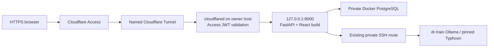

# Cloudflare deployment preparation

Status: **local deployment profile prepared and tested; public deployment NOT_RUN**.
This release uses authored synthetic data. A named hostname, the owner's Cloudflare
tunnel credentials, and an Access application must be configured before publishing.
No account login, DNS change, tunnel creation, public exposure, or remote server change
was performed by this preparation work.

## Placement

The supported path keeps the existing full application on the owner's Docker host:



The browser uses one HTTPS origin for the frontend and `/api/v2`; credentials and
CSRF remain application-controlled. Static Pages hosting alone does not run this
Python application, PostgreSQL, file storage, or the private model connection.
This plan does not move those services into Workers or Pages.

The owner host, Docker, storage, SSH route and `cloudflared` must remain running.
If the workstation sleeps or loses connectivity, the POC becomes unavailable.
This is a synthetic demonstration deployment path, not a hospital availability plan.
Only the app is routed: do not publish PostgreSQL, Ollama, SSH, backup folders or
the Docker management interface. Cloudflare terminates public HTTPS; host-local
HTTP from `cloudflared` to `127.0.0.1` is limited to the trusted host.

## Inputs still required

- A hostname on a domain the owner controls in Cloudflare, such as `his.<owned-domain>`.
- A named, locally managed tunnel UUID and its private credentials JSON file.
- A Cloudflare Access self-hosted application covering that exact hostname,
  its team name and application audience tag, and an allow policy for intended testers.
- Explicit publication of that chosen hostname and a host that can stay online.

Do not paste a tunnel secret, certificate, API token, password or private key into
the repository or chat. `cloudflared` was found locally at version2026.10.7;
no existing owner tunnel credential files were found in the default user directory
at inspection. An installed binary is not proof of a configured Cloudflare account.

## Prepare locally without publishing

From the repository root:

```powershell
python scripts/cloudflare_prepare.py init
```

Edit the created `var/cloudflare/settings.json` privately. Its fields are shown in
[`deploy/cloudflare/settings.example.json`](../deploy/cloudflare/settings.example.json).
The checked-in example deliberately fails validation. Supply actual operator values:

| Field | Meaning |
|---|---|
| `hostname` | Lowercase public hostname, without scheme, path, wildcard or port |
| `tunnel_id` | Existing named tunnel UUID |
| `credentials_file` | Absolute path to that tunnel's private credentials JSON |
| `access_team_name` | Team subdomain only; omit `.cloudflareaccess.com` |
| `access_audience_tag` | Exact Access application's 64-character audience tag |
| `origin_port` | Existing app's `HIS_WEB_PORT`, normally8000 |

Keep the credential file outside Git. The helper reads it only to check its shape
and matching tunnel ID; generated configuration contains its path, not its secret.
The helper never authenticates, changes DNS, creates or runs a tunnel.

```powershell
python scripts/cloudflare_prepare.py prepare
python scripts/cloudflare_prepare.py validate
```

Generated files are under the ignored `var/cloudflare/` directory:

- `tunnel.json`: one hostname, loopback app origin, mandatory Access JWT check,
  and a final404 catch-all. JSON is accepted by the installed cloudflared YAML parser.
- `compose.override.json`: Secure session cookies, the exact HTTPS login origin,
  and a90-second AI transport deadline. Database and file volumes are retained.

`validate` checks the credential binding and unchanged generated files, runs the
installed `cloudflared tunnel ingress validate` offline, and resolves Compose
without printing secrets. It rejects wildcard/malformed/example hostnames,
missing Access configuration, public app port binding, exposed database ports,
port mismatches, and stale generated files. Environment values override `.env`;
make `HIS_WEB_PORT` match `origin_port` before validation.

A successful local result does not validate the remote Access policy, ownership,
DNS, certificate issuance, tunnel connectivity, or the external browser workflow.

## Owner publication sequence

Use these steps only after the named inputs are supplied and the chosen deployment
is authorized. The preparation tool does not execute them.

1. Create or select the named tunnel in the owner's account and configure an Access
   application/allow policy for the exact hostname. Configure Access before routing
   public requests. Obtain its audience tag and use it in private settings.
2. Prepare/validate the profile as above, and retain a fresh backup of the synthetic
   database and files using the existing D38 backup workflow.
3. Start or rebuild the normal local app with `python scripts/dev.py start`. This
   verifies the opted-in private dr-train route and migrates without seeding/resetting.
4. Apply the reviewed HTTPS profile on the existing app service:

   ```powershell
   docker compose -f compose.yaml -f var/cloudflare/compose.override.json up -d --no-deps app
   ```

5. Map the named hostname to that tunnel in the owner account. For a locally managed
   tunnel, the documented CLI action is `cloudflared tunnel route dns <TUNNEL_UUID> <HOSTNAME>`.
   It changes public DNS; this action was not run in preparation.
6. Run the connector on the owner host, substituting its UUID:

   ```powershell
   cloudflared tunnel --config var/cloudflare/tunnel.json --disable-path-normalization=false --metrics 127.0.0.1:20241 --no-autoupdate run <TUNNEL_UUID>
   ```

   This is a foreground interactive operator command. If installing a background
   service later, use the platform's service mechanism and private credential handling.
   Do not enable debug-level request/header logging. The tested version supports
   explicit URL path normalization; the configuration has no public path exceptions.

7. Complete the external acceptance below before calling the URL accepted.

Cloudflare Access adds an outer allow gate; it does not replace HIS login,
organization/facility/patient scope, CSRF, permissions or human approval. The
connector requires an Access JWT with the configured team/audience before forwarding
requests. This is not equivalent to the application verifying JWTs itself. An
operator with trusted local host access can still reach the loopback app directly
and must still pass HIS login. Do not expose that loopback origin through another
proxy or port forwarding path that bypasses the Access gate.

## External acceptance after publication

Check from another browser/network:

1. A visitor outside the allow policy is denied before reaching HIS. No Access
   bypass policy or unprotected path exposes the app or API.
2. An allowed visitor reaches the HTTPS login and can sign in to HIS. Inspect the
   session cookie: Secure, HttpOnly, SameSite=Strict. Origin matches the chosen hostname.
3. Refresh `/patients` and `/domains/D37`; API and assets stay on the same origin.
   Other roles/patient contexts remain denied by the server.
4. Save a synthetic document/task, invoke the real pinned Typhoon route once,
   inspect the five findings/evidence, edit, approve, commit and reload the result.
   Preserve the returned run/model provenance. Do not treat this as clinical validation.
5. Confirm private credentials never enter the frontend/network response. Confirm
   PostgreSQL and model ports remain private and Cloudflare caching respects `no-store`.
6. Verify restart persistence and backups. Record the deployed source revision,
   hostname, execution time, evidence and any failed outcomes separately from local tests.

## Long requests and recovery

Cloudflare currently documents a125-second default proxy read limit. The local
model profile allows180seconds, so this deployment override uses90seconds to leave
room for final database writes and a response. This is a conservative configuration,
not a guarantee against every edge timeout or stalled database lock. Model/transport
timeouts remain retained failures with no mock fallback. A client timeout is not
proof that the remote engine cancelled computation.

If the browser loses a response, retry the same operation key or use the existing
readback/recovery path. Do not create a new inference or commit merely because the
first response was lost. Requests that routinely need longer execution should move
to a separately designed asynchronous status-polling flow before broader deployment.

Running plain `python scripts/dev.py start` later reapplies the development Compose
profile. Reapply the Cloudflare override before starting/restarting the public
connector; otherwise Secure cookies and the public origin settings are lost. For
local development rollback, stop the known connector, run that normal launcher,
and keep all database/file volumes. Do not delete tunnels, DNS or volumes as rollback.

## Verification boundary and sources

Local unit tests cover profile validation, credential binding, Access-required
configuration, Secure cookie/origin settings, private bindings and tamper detection.
The installed cloudflared ingress parser and resolved Docker Compose profile were
also checked with a temporary synthetic credential fixture. No fixture was used to
connect to Cloudflare. Remote Access/DNS/external-browser acceptance remains NOT_RUN.

Official sources checked13November2026:

- [Locally managed tunnel configuration](https://developers.cloudflare.com/tunnel/features/locally-managed-tunnels/configuration-file/)
- [Origin parameters and Access JWT validation](https://developers.cloudflare.com/tunnel/reference/origin-parameters/)
- [Self-hosted public application and Access](https://developers.cloudflare.com/cloudflare-one/access-controls/applications/http-apps/self-hosted-public-app/)
- [Cloudflare proxy connection limits](https://developers.cloudflare.com/fundamentals/reference/connection-limits/)
- [Error524 and long-running request handling](https://developers.cloudflare.com/support/troubleshooting/http-status-codes/cloudflare-5xx-errors/error-524/)

## Owner-selected target

The owner selected his.ai-cie.com and confirmed an existing Cloudflare account without a Tunnel. No account changes were made. Follow [Thai setup/resume steps](CLOUDFLARE_SETUP_TH.md); private settings contain the hostname, while tunnel/Access values remain pending.
