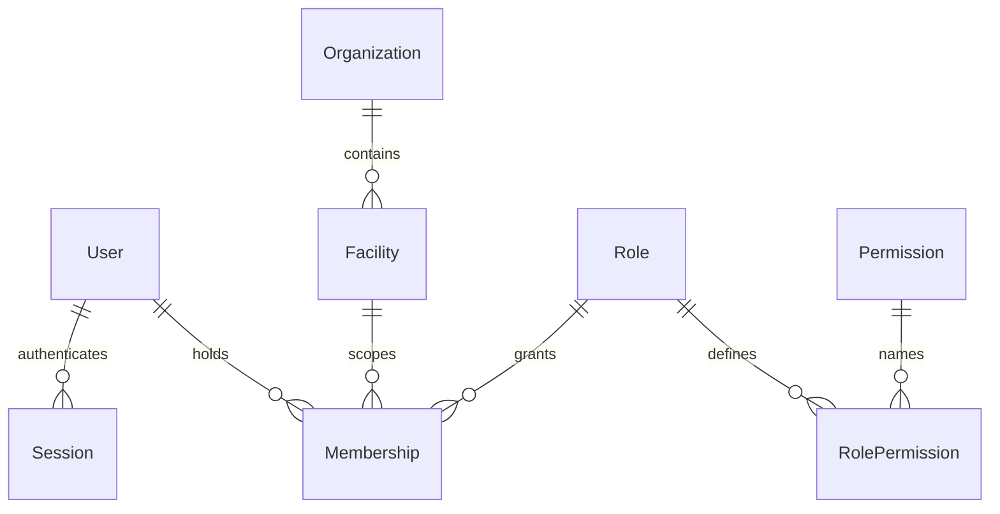
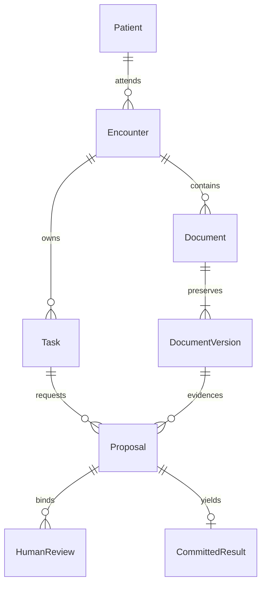
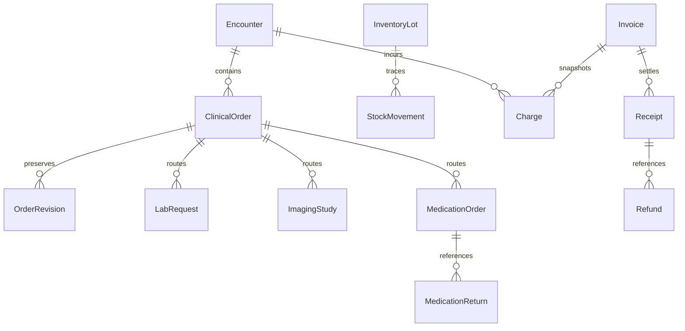

# Shared relational model

The exact columns/types/nullability/foreign keys are generated in DATA_DICTIONARY.csv and contracts/v2/schema-reference.sql. Alembic is authoritative for constraint triggers and operational upgrades. These diagrams show ownership and important links; they deliberately do not imply that all108 tables fit into one clinical entity.

Patient/encounter/organization/facility relationships use composite scope foreign keys where implemented. CareAssignment restricts clinician/nurse patient access; UserPatientScope binds portal identity. Actor permissions are derived from active memberships and persisted grants, then restricted by credential status. Idempotency replay binds active organization/facility and permission scope.

Document content revisions, review evidence and completed results are immutable at DB boundary. Editable workflow headers use expected version and explicit transitions. Stock movements and financial facts use append-only correction/return/reversal records; quantity(NUMERIC18,3) and money(NUMERIC18,2) avoid binary-floating accounting. Timestamp columns use timezone-aware UTC; UI datetime-local controls convert to ISO offset before API calls.

JSONB contains versioned snapshot/event/model/analytics payloads, not a replacement for shared identity or the principal financial/stock relations. File store metadata carries checksum and authorized owner; bytes are external to PostgreSQL and included separately in backup verification.
