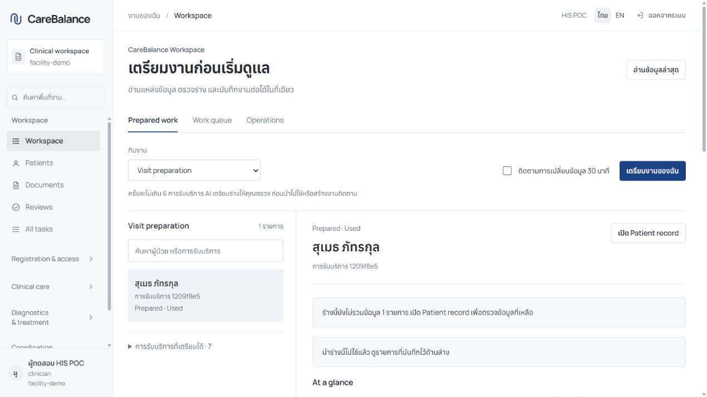

# CareBalance AI workspace release

15 November2026 Thailand time. The protected synthetic POC is available at
**[his.ai-cie.com](https://his.ai-cie.com)**. Pass the existing Cloudflare Access
email check, then use the existing **test01** account and the owner-provided
password. No password, Access token or private ENV is included in this repository.

## Start with the work

Open **Workspace → Prepared work**, choose an available team, then expand
**การรับบริการที่เตรียมได้** and prepare one visit. The batch action can prepare
up to six eligible visits. A page read, profile selection or3D view does not
request generation. While a request is queued, staff can read the patient record
or use Work queue.

Read **At a glance**, the source evidence and the omission notice. Open the wide
**Patient record** panel to read documents outside the compact model excerpt.
Edit the proposed draft and select the ordinary follow-up actions explicitly.
Applying saves a new draft/task or links an appropriate existing open review.
It does not sign a note, prescribe, order an investigation or release a result.
Refresh to inspect the saved effects. A changed source makes an earlier artifact
stale; it never rewrites that artifact or the saved old draft.

An explicit watch follows a visit for up to30minutes, scans about every30seconds
and permits at most three automatic preparations. It prepares again only when
eligible source data change, subject to the shared model admission limit. Pause
the watch when finished. Pristine assistant-created drafts/tasks are excluded
from preparation triggers, including across profiles.

**Operations opens with2D lists.** The optional3D button loads an illustrative
hospital layout and the same scoped work. It is not a real floor plan, staff
location service or claim of autonomous hospital agents. Both views can open
the existing prepared visit;3D is off again when returning to Operations.

## Actual acceptance

| Boundary | Executed evidence |
| --- | --- |
| Runtime | Source286f391, image9afd73f2, explicit migration0005, nonroot app and20 authenticated assets |
| Persistent worker | Foreground cron process observed from a fresh SSH session; image/config/privateENV pins matched; owned one-off removed; reboot approval recorded |
| Real model | Six successful normal-application Typhoon calls across four profiles; one corrected nursing-source reserve; no automatic retries |
| Public browser | One visit: queue, source evidence, omitted full note, explicit demonstration edit, apply and full reload |
| Other staff | Existing nurse, registration and laboratory accounts through normal authenticated production APIs, CSRF and idempotency |
| Saved work | Five decisions, seven effects: two draft documents, two new follow-up tasks, three links to existing tasks |
| Duplicate protection | Actual identical-key HTTP apply replay for nursing, records and laboratory preserved the same effects |
| Role boundaries | Nine real checks: another actor's run hidden, forbidden profiles403, unassigned nurse context hidden, records document body absent |
| Watch | Unchanged input produced zero automatic runs; authored document v1→v2 produced one run; its effect reused the existing records task; test watch paused |
| Preservation | All pre-test rows in126HIS/2LabClear/10DR tables, existing files/config and non-app identities preserved; deliberate HIS test appends recorded separately |
| Responsive/3D | Protected desktop and390px patient reading; actual optional WebGL rendering and room navigation;2D restored afterwards |

The initial nursing run used old test-document content. Its source-grounded
output was retained without applying it. A separate authored synthetic handover
then supplied an appropriate source for the nursing workflow. This consumes one
of the two reviewed reserve calls rather than erasing the original attempt.

The watch test deliberately revised one authored source. The earlier visit and
records preparations may consequently display stale-source status in the demo.
Their saved drafts and evidence remain available. A fresh preparation requires
an explicit request using the current source.

Measured provider time for these six calls was50.579–56.381seconds; queue-to-
completion was50.859–69.318seconds. These are observations of a small synthetic
trial, not a benchmark, response-time promise or measured staff-time savings.
Monetary cost remains unmeasured/null. The application trial used6of7 calls;
no remaining trial call runs automatically. The separate five-call direct
qualification budget is exhausted. Local development defaults remain mock;
the named protected deployment has the four qualified live profiles enabled.

## Limits of the result

Visit preparation included6of7 eligible sources; the corrected nursing excerpt
included4of12. Records and laboratory included4of4 and7of7 respectively. The UI
reports omissions. Drafts mainly copy the included authored notes and some facts
select titles or dates of birth. This verifies source-linked preparation and
ordinary workflow effects; it does not establish comprehensive clinical
synthesis, clinical accuracy or workload reduction for every department.

The earlier187 disposable PostgreSQL tests,156 mounted frontend checks,31unit
checks, typecheck and build cover their frozen source. The historical38-domain
and10-journey baseline is separate. Host reboot, clinical effectiveness,
all38domains using realAI, DR/CAD inference and MedGemma27B qualification remain
unestablished. Ten owner-renamed MMRDR images remain held for laterality. The
original DR repository and existing LabClear owner edits are preserved.

## Operator handoff

The app is running on dr-train; Git publication does not deploy it. Preserve the
three original Compose/ENV inputs and use the separately bound assistant overlay
when maintaining this runtime. Keep the app and worker on the same immutable
image. Published worker templates remain disabled/unbound defaults; their
installation is not the current host's activation proof.

On dr-train, the existing deployment owner can inspect the guard:

```sh
python3 /home/chaw/his-poc/var/assistant-worker-guard-v2/bin/control.py status --state /home/chaw/his-poc/var/assistant-worker-guard-v2
```

To fence new dispatch, use the same command with `pause` instead of `status`.
Neither command proves physical drain or cancels a running model. The deployed
templates expose no generic enable/retry/UNKNOWN-clear command. Unknown outcomes
must retain their evidence and require exact terminal/admission reconciliation.
Before rollback, pause, allow natural completion, prove both model endpoints and
GPU0 drained and inspect persisted global admission. Keep all queued work,
watches, immutable revisions, decisions, effects and audits. A separately
qualified0005-compatible fallback exists; no production downgrade/restore or
recovery execution is claimed by this release.

The worker container has1CPU/1GiB/128PID limits; the dedicated model service uses
GPU0 and6CPU/12GiB limits. The cron supervisor has bounded diagnostic buffers,
with no claimed OS CPU/RAM quota. Capacity is checked before dispatch, not
exclusively reserved. Shared Ollama and GPU1 research remain separate.

Evidence: [application](../evidence/ai-driven-root-20261114/application-acceptance.json),
[runtime witness](../evidence/ai-driven-root-20261114/assistant-runtime-readback.json),
[deployment](../evidence/ai-driven-root-20261114/deployment-readback.json),
[public browser](../evidence/ai-driven-public-20261114/visit-browser-acceptance.json),
[screenshots](../evidence/ai-driven-public-20261114/),
[source contracts0005](integrations/contracts-0005/),
[Cloudflare setup](CLOUDFLARE_SETUP_TH.md),
[deployment operations](DEPLOY_DR_TRAIN.md).


