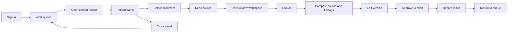

# CareBalance User Journey

## AI preparation

สถานะ15 พฤศจิกายน2026: เปิดใช้บน his.ai-cie.com แล้ว ทดสอบโมเดลจริงผ่านระบบ6ครั้ง
หน้าเว็บจริงผ่านเส้นทางเตรียมงานก่อนพบแพทย์ แก้ร่าง บันทึก และโหลดซ้ำ ส่วนพยาบาล เวชระเบียน
และแล็บทดสอบผ่านบัญชีและ API ของระบบที่ deploy จริง ดู [ขอบเขตผลตรวจ](RELEASE_AI_WORKSPACE.md)
ข้อมูลสาธิตบางรายการแสดงว่าต้นทางเปลี่ยน เพราะรอบทดสอบ watch แก้เอกสารเป็นรุ่นใหม่ตามขั้นตอน
ร่างและผลเก่ายังคงอยู่ หากต้องการร่างจากข้อมูลล่าสุด ให้เลือกเตรียมการรับบริการนั้นใหม่อย่างชัดเจน

1. หลัง Sign in เปิด **Workspace** เลือกทีมตามสิทธิ์ของบัญชี เปิดรายการ
   **การรับบริการที่เตรียมได้** แล้วกด **เตรียม** เฉพาะรายที่ต้องการ
   หรือใช้ **เตรียมงานของฉัน** เพื่อเตรียมการรับบริการไม่เกิน6รายการ
   ระหว่างรอสามารถทำงานใน **Work queue** หรืออ่าน Patient record ต่อได้
2. เลือกรายการที่เตรียมเสร็จ อ่าน **At a glance** และแหล่งอ้างอิง
   หากมีข้อมูลที่ยังไม่รวมในร่าง หน้าจอระบุจำนวนให้เห็นก่อนนำร่างไปใช้
   เปิด **Patient record** เพื่ออ่านต้นฉบับใน panel กว้าง
3. ตรวจร่างและแก้ข้อความตามที่ต้องการ เลือกรายการที่จะบันทึก แล้วกดใช้ร่าง
   ระบบบันทึกร่างและสร้างหรือเชื่อมงานติดตามในครั้งเดียวตามสิทธิ์
   การรับรองเอกสาร สั่งยา เผยแพร่ผล และลงนามยังเป็นขั้นตอนเฉพาะของงานนั้น
4. เปิดรายการที่บันทึกเพื่อตรวจซ้ำหลัง refresh ระบบใช้ผู้ป่วย การรับบริการ
   รุ่นข้อมูล และแหล่งอ้างอิงเดิม หากต้นทางเปลี่ยนจะไม่นำร่างเก่าไปใช้
5. หากต้องการ เลือกติดตามข้อมูล30นาที AI จะเตรียมใหม่เฉพาะเมื่อข้อมูลต้นทาง
   เปลี่ยน ไม่เกิน3รอบ และหยุดติดตามได้ การเปิดหน้าหรืออ่านเอกสารไม่เรียก AI

| Team | งานที่เตรียมให้ตรวจ | งานต่อที่เลือกบันทึกได้ |
| --- | --- | --- |
| Visit preparation | ข้อมูลจากบันทึก ผลแล็บที่มีสิทธิ์อ่าน และงานในบริบทนี้ | ร่างบันทึกและงานตรวจเอกสาร |
| Nursing handover | บันทึกและงานพยาบาลตามสิทธิ์ โดยไม่เปิดข้อมูลแล็บให้สิทธิ์พยาบาลเดิม | ร่างส่งเวรและงานติดตาม |
| Records readiness | ข้อมูลผู้ป่วย การรับบริการ และข้อมูลกำกับเอกสาร | งานทบทวนข้อมูล โดยไม่ส่งเนื้อหาเวชระเบียนให้โมเดล |
| Laboratory handoff | ค่าผลที่เผยแพร่แล้ว หน่วย ช่วงอ้างอิง และสถานะที่บันทึกไว้ | เชื่อมงานทบทวน LabClear เดิมหรือสร้างงานติดตามตามสิทธิ์ |

**Operations** เป็นมุมมองเสริมสำหรับเปิดดูงานตามแผนก มีรายการที่ใช้งานได้
เหมือนกันทั้งแบบ2Dและ3D ภาพ3Dเป็นผังสาธิต ไม่ใช่ผังอาคารจริงหรือตำแหน่งบุคลากร
Operations เริ่มจากรายการ2D เลือกเปิด3Dเองได้และปิดกลับได้ทันที โดยไม่กระทบเส้นทางหลักข้างต้น

หลักฐานการเปิดใช้และข้อจำกัด:
[implementation contract](AI_DRIVEN_CONTRACT_V1.md),
[bounded qualification plan](AI_PROFILE_QUALIFICATION_PLAN.md)

## DR image review

เส้นทางทบทวนภาพสังเคราะห์เปิดผ่านเว็บที่ป้องกันด้วย Access แล้ว และผ่านการตรวจร่างที่บันทึกไว้บนรุ่นล่าสุด
ดูสถานะตามจริงที่ [DR release checkpoint](integrations/DR_RELEASE_20261114.md)

1. เปิด Imaging ในบริบทผู้ป่วยและ encounter ที่ต้องการ เลือกภาพที่เผยแพร่แล้ว
   แล้วเปิด **Review with DR** ใน panel กว้าง ตรวจชื่อผู้ป่วยและข้อมูลข้างตา
2. เลือกภาพที่ลงทะเบียนพร้อมที่มาแล้ว เลือกหรือสร้างงานทบทวนแยกจากงานรับภาพเดิม
   ตรวจชุดภาพและยืนยันการส่งอย่างชัดเจน ไม่มีการเรียกโมเดลอัตโนมัติ
3. เปิด **DR workspace** ตรวจภาพและบริบท แล้วกด **Confirm image** การยืนยันภาพ
   และการตรวจคุณภาพเป็นคนละขั้นตอน ต้นฉบับไม่ถูกเขียนทับ
4. ใช้ **Report** เตรียมร่างตามสิทธิ์ การยืนยัน grade และลงนามต้องมีสิทธิ์เฉพาะ
   ที่ตรวจสอบแล้ว บัญชี test01 ไม่มีสิทธิ์สองรายการนี้
5. เปิดร่างที่บันทึกแล้วเพื่อตรวจค่าซ้ำ สำหรับรายงานที่ลงนามแล้ว ใช้
   **Check current review** ตรวจว่าข้อมูลต้นทางเปลี่ยนหลังลงนามหรือไม่
   ลายเซ็นเดิมและการประเมินปัจจุบันแสดงแยกกัน
6. **Back to CareBalance** กลับสู่ผู้ป่วย encounter และภาพเดิม หากคำสั่งยัง
   ไม่ทราบผล สามารถปิด panel โดยเก็บคำสั่งไว้ แล้วเปิดตรวจคำสั่งเดิม
   ไม่ส่งซ้ำด้วยคำสั่งใหม่ ระหว่างนั้นพื้นที่ที่นำเข้าแล้วเปิดอ่านได้

ภาพที่เจ้าของระบุว่าเป็น MMRDR ทั้ง10ไฟล์ เก็บรอข้อมูลข้างตาตามที่เจ้าของเลือก
ยังไม่ผูกผู้ป่วย จับคู่ภาพ ส่งให้ DR หรือเรียกโมเดล ชื่อไฟล์ถูกเจ้าของเปลี่ยนเอง
จึงไม่ใช้ชื่อไฟล์เดาข้างตาหรือเปลี่ยนแหล่งอ้างอิง

ขอบเขต: งานอ่านเอกสารและตรวจความครบถ้วนด้วย AI บนข้อมูลสังเคราะห์
อัปเดตตามข้อเสนอแนะของเจ้าของวันที่14 พฤศจิกายน2026

## Lab result review

ผู้มีสิทธิ์เปิด Laboratory เลือกผู้ป่วย การรับบริการ และผลแล็บที่เผยแพร่แล้ว
จากนั้นเลือก **Review with LabClear** ระบบแสดงต้นฉบับให้ตรวจเทียบใน panel กว้าง
เลือกงานทบทวนเดิมหรือสร้างงานใหม่อย่างชัดเจน แล้วกดส่งค่าต้นฉบับ
ตรวจ Test, Value, Unit และ Reference แก้ค่าที่ต้องการแยกจากต้นฉบับ
ยืนยันว่าเป็นผู้ป่วยในบริบทนี้ก่อนกด **ยืนยันการทบทวน**

ผลที่ยืนยันแล้วเปิดอ่านย้อนหลังได้ ช่องแก้ไขถูกปิด ต้นฉบับ HIS ยังอยู่ครบ
และระบบไม่ปิดงานหรือเผยแพร่ผล HIS ให้อัตโนมัติ หากยังไม่ทราบผลคำขอ
ให้ตรวจคำสั่งที่รออยู่และใช้คำสั่งเดิม ระบบเก็บรายละเอียดสำหรับกู้คืนหลัง refresh
การเปิดผ่านลิงก์หลัง Sign in จะกลับสู่ผู้ป่วย การรับบริการ และรายการเดิม
ปิด panel ด้วย Escape แล้วโฟกัสกลับไปปุ่มที่เปิด

เส้นทางนี้ผ่านการทดสอบ PostgreSQL และหน้าจอจริงทั้งระบบส่วนตัวและ URL สาธารณะ
ด้วยข้อมูลสังเคราะห์ ยืนยันแล้วว่าอ่านค่าที่บันทึกได้หลัง refresh หลักฐานแยกใน
[integration checkpoint](integrations/VALIDATION_CHECKPOINT_20261114.md)
ส่วน DR รองรับงานทบทวนภาพโดยคนตามสิทธิ์ ไม่มีการอ้างว่าภาพที่รอข้างตาถูกวิเคราะห์ด้วยโมเดล

## เป้าหมายของผู้ใช้

ผู้ตรวจเอกสารต้องรู้ว่ากำลังทำงานกับผู้ป่วยและการรับบริการใด อ่านต้นฉบับได้
สะดวก ตรวจข้อค้นพบ แก้ไขและอนุมัติรุ่นที่ถูกต้อง แล้วกลับไปทำงานถัดไปได้
ผู้ใช้ที่มีสิทธิ์ต่างกันเห็นข้อมูลและคำสั่งตามที่เซิร์ฟเวอร์อนุญาต

## จุดที่พบจากเว็บจริง

บน Chrome กว้าง1536px พื้นที่ Document preview ด้านขวามีความกว้าง330px
ข้อความไทยและชื่อเอกสารยาวจึงตัดหลายบรรทัด และชื่อผู้ป่วยในแถวยังเปิดแฟ้ม
โดยตรงไม่ได้ การอ่านต้นฉบับต้องใช้พื้นที่กว้างกว่าข้อมูลสรุปของคิว
นี่เป็นข้อสังเกตจากหน้าจอจริงและความคิดเห็นเจ้าของ ไม่ใช่ผล usability study

## เส้นทางหลักที่ปรับ

| ช่วงงาน | สิ่งที่ผู้ใช้ทำ | การตอบสนองที่ต้องมี |
|---|---|---|
| เข้าใช้งาน | ยืนยันอีเมลใน Cloudflare Access แล้ว Sign in HIS | ใช้บัญชีและสิทธิ์เดิม ข้อผิดพลาดบอกให้ลองใหม่ได้ |
| เลือกงาน | ค้นหาใน Work queue หรือเลือกชื่อผู้ป่วย | คิวแสดงงานจริง ผู้ป่วยและ encounter ของแถวชัดเจน |
| เปิดแฟ้ม | เลือกชื่อผู้ป่วยหรือ Open patient record | เปิด panel แยกขนาดกว้าง คิวเดิมยังอยู่ด้านหลัง |
| อ่านเอกสาร | เลือกเอกสารใน panel หรือเปิด visit ที่ต้องการจากรายการ | หัวผู้ป่วยคงที่ เนื้อหาอ่านในพื้นที่หลัก รุ่นเอกสารและสิทธิ์เนื้อหาตรงกัน การเปลี่ยน encounter ทำในพื้นที่ visit ที่เปิดต่อ |
| ปิดแฟ้ม | ปิด panel หรือกด Escape | กลับจุดเดิมของคิว คืนโฟกัสให้ปุ่มที่ใช้เปิด |
| ทำงานต่อ | เลือก Open document, Open review หรือ Open visit | เปิดพื้นที่ทำงานเดิมพร้อม patient/encounter/document/task ที่ตรงกัน |
| ตรวจด้วย AI | ยืนยันงานและต้นฉบับ แล้วส่งตรวจ | แสดง provider จริง สถานะกำลังทำงาน และเก็บผลล้มเหลว ไม่เปลี่ยนเป็น mock เงียบ ๆ |
| ทบทวน | เทียบข้อค้นพบกับต้นฉบับ แก้ข้อความตามที่เห็น | ข้อความอ้างอิงผูกต้นฉบับ การแก้ไขสร้าง action version ใหม่ |
| อนุมัติและบันทึก | อนุมัติรุ่นที่อ่าน แล้ว Record result | เซิร์ฟเวอร์ตรวจรุ่น/hash/สิทธิ์อีกครั้ง ไม่บันทึกซ้ำเมื่อ retry |
| ตรวจผลย้อนหลัง | เปิดงานเดิมหรือ reload | เห็นผลที่บันทึกจริง และปิดคำสั่งแก้ไข/อนุมัติซ้ำของผลนั้น |

## กติกาของ Patient panel

Panel ใช้อ่านข้อมูลและเลือกงานที่จะทำต่อ การเขียนข้อมูล การเรียก AI และ
การอนุมัติยังอยู่ในพื้นที่ทำงานเดิม เพื่อให้ผู้ใช้เห็นต้นฉบับและรุ่นที่กำลัง
ยืนยันอย่างชัดเจน บริบทของคิวไม่เปลี่ยนเพียงเพราะเปิดหรือปิดแฟ้มอ่าน

ด้านขวาของ Home ใช้ข้อมูลสรุปสั้น ๆ และทางเข้าแฟ้ม ส่วนเนื้อหาเอกสารอ่าน
ใน panel กว้าง บนมือถือใช้ตัวเลือกเอกสารแบบย่อและพื้นที่หน้าจอสำหรับอ่าน
เมนูและปุ่มมีชื่อสำหรับผู้ใช้คีย์บอร์ดและโปรแกรมอ่านจอ

## ทางออกเมื่อทำงานต่อไม่ได้

| สถานการณ์ | พฤติกรรมที่ต้องมี |
|---|---|
| กำลังโหลด | บอกว่ากำลังโหลด แยกจากไม่มีเอกสาร |
| ไม่พบเอกสาร | บอกว่ายังไม่มีในบริบทนี้ และให้เปิดพื้นที่เอกสารตามสิทธิ์ |
| อ่านได้เฉพาะ metadata | แสดงชื่อ/รุ่นที่อนุญาต พร้อมเหตุผลที่ไม่แสดงต้นฉบับ |
| เซิร์ฟเวอร์ปฏิเสธหรือเครือข่ายผิดพลาด | แสดงข้อผิดพลาดจริง ไม่แสดงว่าเป็นแฟ้มว่าง หากเครือข่ายมีปัญหาให้ปิด panel แล้วเปิดใหม่เพื่อลองโหลดอีกครั้ง |
| สลับผู้ป่วยหรือ encounter ระหว่างรอ | ล้างเอกสารเดิม และทิ้งคำตอบที่มาถึงช้าของบริบทก่อนหน้า |
| ลิงก์มี document/task ต่างบริบท | ไม่เปิดคำสั่งส่ง AI จนกว่าจะเลือกข้อมูลที่ตรงกับบริบท |
| บันทึกแล้วแต่คำตอบขาดหาย | ใช้คำสั่งและ key เดิมตรวจผล ไม่สร้างผลใหม่จากความไม่แน่ใจ |

## วิธีตรวจรับ

ตรวจจาก UI จริง: เปิดแฟ้มจากชื่อผู้ป่วยและปุ่มสรุป อ่านเอกสาร ปิดด้วย
Escape/ปุ่มปิดแล้วกลับคิวเดิม ใช้ Tab อยู่ภายใน panel เลือกเอกสารและเปิด
visit ที่ต้องการด้วยบริบทตรงกัน ทดสอบทั้ง desktop และมือถือ จากนั้นรันเอกสาร
สังเคราะห์ผ่าน AI จริง แก้รุ่น อนุมัติ บันทึกและ reload พร้อมตรวจฐานข้อมูล
แบบอ่านอย่างเดียว หลักฐานที่ยังไม่ได้รันต้องคงสถานะ NOT_RUN

## Current realistic patient journey

ค้นหา HN6901425 จาก Work queue แล้วเปิดชื่อสุเมธ ภัทรกุล เพื่ออ่านแฟ้มกว้าง
หัวแฟ้มแสดง HN อายุ58ปี เพศชาย และ OPD ตามข้อมูลที่บันทึก เอกสารมีประวัติ
และสัญญาณชีพตัวอย่าง เปิด Review ต่อในงาน/เอกสารเดิมได้ หรือเปิด Laboratory
อ่านผล FPG152mg/dL และเลือก Review with LabClear เพื่อเตรียมงานทบทวน
ทุกชื่อและค่าแต่งขึ้นสำหรับสาธิต หลักฐานรอบนี้อยู่ใน RELEASE_REALISTIC_PATIENTS.md

## Next AI-driven journey: active implementation

เจ้าของต้องการให้ AI ช่วยทีมรักษา/พยาบาล เวชระเบียน/ธุรการ และแล็บทั้งหมด
เป้าหมายถัดไปคือคิวงานที่ AI เตรียมข้อมูลและร่างงานให้ พร้อมหลักฐานต้นทาง
ผู้ใช้ทบทวนแล้วนำร่าง/งานติดตามไปใช้ได้ตามสิทธิ์เดิม มุมมอง3Dจะเปิดงานเดียวกับ
รายการปกติและแสดงสถานะจริง ขั้นตอนนี้ยังไม่ถูกนำขึ้นเว็บหรือผ่านการเรียกโมเดลจริง
