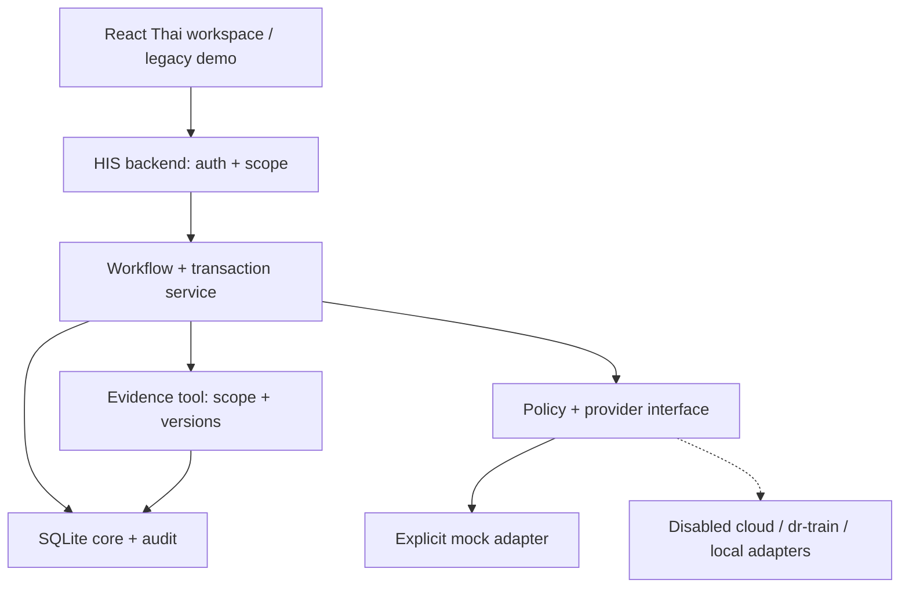

# สถาปัตยกรรม HIS POC starter

สถานะ: modular monolith สำหรับ synthetic demo หนึ่งเส้นทาง; ภาพทั้งโรงพยาบาลอยู่ใน DOMAIN_SCOPE.csv ไม่ใช่คำกล่าวว่า implement ครบแล้ว รุ่นสัญญาเริ่มที่ v1 ทั้ง clinical effectiveness และ production readiness ยังไม่ได้ประเมิน

## ขอบเขตและเจ้าของข้อมูล

| Module | เป็นเจ้าของ | อนุญาตให้ทำใน starter |
|---|---|---|
| Identity/access | users, roles, grants | demo token → principal ฝั่ง server; scope check ทุก service/tool |
| Patient/encounter | patient identity, encounter status/version | fixture identity; ตรวจความสัมพันธ์ก่อนอ่าน/เขียน |
| Documents/evidence | document version, text, evidence locator | อ่านหลักฐานจำกัด encounter; invalidation เมื่อ input เปลี่ยน |
| Workflow | task, proposal revisions, review, committed result | draft → review → commit ตาม hash/version |
| AI runtime | route, adapter, run outcome/usage | mock fixture explicit; external providers fail closed |
| Audit | append activity references | บันทึก actor/action/outcome; ไม่เปิดให้แก้ผ่าน API |
| Specialist boundary | DR/CAD task/result artifacts | design contracts เท่านั้น; ไม่ใช่ generic chat |

Frontend เรียก HIS backend เท่านั้น Credentials ของ inference อยู่ server; ค่า token demo ใช้ synthetic authentication fixture เท่านั้น ไม่ใช่ระบบ login สำหรับใช้งานจริง ห้ามนำ server demo เปิด public การย้ายไป IdP/session/RBAC จริงเป็นงานแยกที่ระบุใน BACKLOG

## Deploy และ inference เป็นอิสระ

| ตำแหน่ง backend | Inference | สถานะ / สิ่งที่ต้องตรวจ |
|---|---|---|
| local development | in-process mock | runnable starter; ดู VALIDATION_REPORT |
| local development | dr-train | NOT_RUN; route/auth/TLS จากเครื่อง backend |
| server | dr-train | NOT_RUN; resource allocation และ existing workload |
| cloud | dr-train | NOT_RUN; private connectivity ที่ได้รับอนุญาต |
| local/server/cloud | cloud API | NOT_RUN; data policy, allowlist, protocol และงบ |
| local/server/cloud | local endpoint | NOT_RUN; local หมายถึง host ที่ endpoint อยู่ ไม่ใช่ browser ของผู้ใช้ |

application_location และ inference_profile เป็นคนละ field การแก้ config ไม่ได้ทำให้ endpoint พร้อมใช้ คำว่า localhost ใน container ต้องตรวจจาก network namespace จริง

## ธุรกรรมและขอบเขตความไว้วางใจ

Model output เป็นข้อมูลเสนอ ไม่ใช่สิทธิ์หรือคำสั่งที่ trusted. Evidence tool ตรวจ principal/patient/encounter เช่นเดียวกับ HTTP boundary. Review ผูกกับ proposal revision และ action payload hash ที่แสดงให้ตรวจ การแก้ของ reviewer ต้องสร้างรุ่นใหม่และอนุมัติรุ่นใหม่ ไม่สืบทอด approval เดิม

Commit ต้องอยู่ใน transaction เดียวกับ persisted result และ audit; ตรวจ current permission, encounter status/version, document versions, proposal version/hash และ approval expiry อีกครั้งก่อนเขียน ป้องกัน check-then-write race ด้วย transaction serialization ของ SQLite. Idempotency key ต้องผูก payload และ scope; key ซ้ำ payload เดิมคืนผลเดิมหลังตรวจสิทธิ์ ส่วน payload ต่างกันเป็น conflict. Starter ไม่มีธุรกรรมไปภายนอก จึงไม่มี outbox worker; ก่อนเพิ่ม external side effect ต้องเพิ่ม outbox + reconciliation แยกจาก retry ของ local commit

## Adapter และ capability

Domain service ไม่รู้ endpoint, SDK หรือ checkpoint. Contract adapter รับ task input + evidence และคืน normalized result; mock ใช้ deterministic fixture ภายใต้ provider interface. Cloud, dr-train, local และ specialist ยังเป็น protocol boundaries ที่ต้อง implement ตาม protocol จริง ห้ามอ้างว่าเปลี่ยน base_url แล้วใช้แทนกันได้

Registry แยก declared_capabilities กับ verified_capabilities. null หมายถึง UNKNOWN; false หมายถึงทดสอบ/ประกาศว่าไม่รองรับเท่านั้น. Verification ต้องผูก exact model revision, artifact, engine, parser/template, config hash, test suite, observed time. ถ้า revision เปลี่ยน ให้ทำ capability revalidation. กรอง reasoning แยกจาก final schema และไม่เก็บ raw reasoning โดย default

## ข้อมูลแลกเปลี่ยน

v1 เป็น internal project contract ไม่ได้อ้าง FHIR conformance. Mapping FHIR/DICOM/payer/ERP เป็น integration-planned ตาม domain. Source catalog เป็นแหล่งอ้างอิงการออกแบบ ไม่ใช่ clinical RAG corpus พร้อมใช้. Source-to-target mapping, jurisdiction, units, terminology versions, correction/cancellation และ acknowledgement ต้องตกลงกับระบบคู่เชื่อมก่อนเปิด adapter

## ข้อจำกัดที่เลือกอย่างตั้งใจ

Backend ยังคง SQLite + stdlib HTTP สำหรับ loopback synthetic demo. Frontend ใหม่ apps/web ใช้ React + TypeScript + Vite มี package-lock.json; web/index.html เดิมคงเป็น reference. Frontend framework เป็น dependency ของ UI ใหม่ ไม่เพิ่ม dependency ใน Python core. Production Python framework/PostgreSQL ยังเป็นงานต่อ. ไม่ประกาศ high availability, throughput, tamper-evident audit หรือ identity verification จริง. ไม่มี training/deployment/server changes/paid calls.

## Frontend และข้อมูลสองโหมด

HTTP adapter เรียก HIS backend ผ่าน local Vite proxy เฉพาะ API/health. Parse JSON-string columns ใน adapter จุดเดียวโดยแยก stored result/action ออกจาก immediate commit response. Fixture adapter ใช้ staging records/frozen states แบบอ่านอย่างเดียว ไม่มี mutation ไป backend และไม่มี silent fallback. โหมด/session change ต้องล้าง context/draft/selection ที่เกี่ยวข้อง. Target task เป็น singleton guard ไม่ใช่ generic routing. ขยายหลายผู้ป่วยต้อง persisted task binding และ authorization/migration tests ก่อน.
