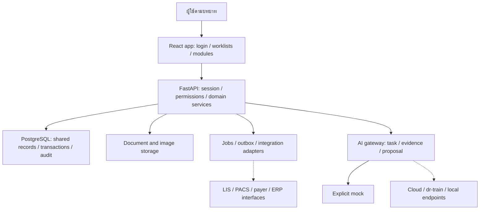

# HIS POC — Full System Development Specification

วันที่: 12 พฤศจิกายน 2026 · Baseline ที่ตรวจ: starter v0.2.0

## 1. การเปลี่ยนเป้าหมายตามคำสั่งล่าสุด

ผู้ใช้ต้องการแอป HIS/ERP ที่เข้าใช้งานผ่าน login มีพื้นที่ทำงานตามบทบาท ใช้ข้อมูลผู้ป่วยและการรับบริการร่วมกัน และทำงานข้ามโมดูลได้ เป้าหมายรอบใหม่จึงเป็น **Full System Development Prototype บน PostgreSQL และข้อมูลสังเคราะห์**

ขอบเขตเดิมที่จำกัดหนึ่ง first slice และ p-demo/e-demo/task-demo เป็นข้อจำกัดของ implementation รุ่นเก่า ต้องยกเลิกอย่างเป็นทางการพร้อม migrations, authorization และ regression tests เมื่อขยายระบบ ปรับ GOAL.md, PLAN.md, BACKLOG.md, AGENTS.md, CODEX_HANDOFF.md และ STARTER_PROMPT_TH.md ให้ตรงคำสั่งใหม่ ห้ามใช้เอกสารเดิมเป็นเหตุให้ส่งกลับเพียง 38 placeholder pages อีกครั้ง

คำว่า Full System ในเอกสารนี้มีเกณฑ์ตรวจ: ทั้ง 38 domains มีความสามารถขั้นต่ำที่บันทึกข้อมูลได้ตาม matrix มีหน้าจอและ actions ของ domain นั้น หลาย journey ใช้ข้อมูลร่วมกัน และการ login/สิทธิ/persistence ทำงานจริง ยังต้องแยก clinical validation, SOP ของโรงพยาบาล, payer certification และ live external integrations ตามหลักฐานเฉพาะงาน ไม่รวมสิ่งเหล่านั้นในคำว่า prototype ผ่าน

## 2. สถาปัตยกรรมที่เลือกสำหรับรอบนี้

| ชั้น | ข้อกำหนด |
|---|---|
| Frontend | เก็บ React + TypeScript + Vite จาก v0.2 ปรับ routing, authentication bootstrap, normalized data/state และหน้าจอรายโมดูล ใช้ component system หลักชุดเดียว |
| Backend | FastAPI modular monolith แยก domain/service/repository/API boundaries; ใช้ business invariants และ tests เดิมต่อ ไม่ทำ 38 microservices |
| Persistence | PostgreSQL 18.x ที่ยัง supported เป็น primary; SQLAlchemy + driver ที่เข้ากันได้ และ Alembic versioned migrations ตรวจและ lock รุ่นที่จะติดตั้งจริง |
| Login | Local development authentication ที่ server ตรวจจริง พร้อม session expiry/revocation และ effective permissions; มี boundary สำหรับ OIDC/SSO ในภายหลัง |
| Files | เก็บเอกสาร/รูปใน file storage ผ่าน interface; local directory สำหรับ development, object storage adapter สำหรับ deployment ภายหลัง PostgreSQL เก็บ metadata/reference/checksum/version |
| Background work | เพิ่ม worker/durable jobs เมื่อมีงานที่ต้องรอหรือ retry พร้อม cancellation/status; เก็บ domain write กับ outbox ใน transaction ที่เหมาะสม |
| AI | Shared task/proposal/review/run service; explicit mock เป็น default ที่รันได้จริง แยก application location จาก inference location |
| Operations | Health/readiness, migrations, deterministic seed, backup/restore scripts, audit และ version/build information |

PostgreSQL เป็นคำแนะนำที่เลือกตามรูปแบบข้อมูลและ concurrency ของโครงการ ดูหลักฐานและ migration plan ใน [POSTGRESQL_DECISION_AND_MIGRATION_TH.md](POSTGRESQL_DECISION_AND_MIGRATION_TH.md) Supabase เป็นทางเลือกด้าน platform/hosting ภายหลัง ไม่เป็น dependency ที่ต้องสมัครก่อนเริ่ม local application

## 3. เปิดระบบแล้วต้องพบอะไร

### 3.1 หน้าเข้าสู่ระบบ

- Root URL ที่ไม่มี session นำไป `/login` แสดงชื่อระบบ ข้อมูล environment แบบกระชับ และแบบฟอร์มบัญชี/รหัสผ่าน
- มี local synthetic accounts ที่ backend ตรวจจากฐานข้อมูล รหัสผ่านเก็บด้วย password-hashing library ที่เหมาะสม ไม่ให้ client เลือก role แล้วได้สิทธินั้นทันที
- หลัง login เรียก current-user/session endpoint เพื่อโหลด user, memberships และ permissions จาก server แล้วพาไป home/worklist ที่ผู้ใช้เข้าถึงได้
- Refresh/deep link ต้องรักษา session ที่ยังใช้ได้ ส่วน session ที่หมดอายุ/ถูกถอนแสดงทางกลับเข้าสู่ระบบและจัดการ draft อย่างชัดเจน
- Logout ต้อง invalidate session ฝั่ง server และล้าง user/patient selection/query cache/draft ฝั่ง client
- มี denied, not found, session expired, network error และ unavailable states ที่มีพฤติกรรมจริง
- Password reset ใน local development ทำผ่าน admin/CLI ที่ตรวจสิทธิได้ หาก email delivery ยังไม่มี ให้แสดงสถานะตามจริง ไม่แสดงว่าได้ส่งอีเมลแล้ว

ใช้ server session ผ่าน HttpOnly cookie เป็นค่าเริ่มต้นที่เสนอ พร้อม Secure ใน HTTPS profile, SameSite และ CSRF protection สำหรับ mutation; dev HTTP บน loopbackต้องเป็น explicit environment configuration คง session token ออกจาก localStorage และไม่ใส่ demo bearer-token panel เป็น login หลัก

หลักการ session/cookie และ password storage อ้างอิง [OWASP Session Management](https://cheatsheetseries.owasp.org/cheatsheets/Session_Management_Cheat_Sheet.html) และ [OWASP Password Storage](https://cheatsheetseries.owasp.org/cheatsheets/Password_Storage_Cheat_Sheet.html) ให้ใช้ library ที่ดูแลอยู่และตรวจพฤติกรรมจริง ไม่สร้าง cryptography เอง

### 3.2 Home ตามบทบาท

Home แสดงงานที่เกี่ยวข้องและตัวนับที่คำนวณจาก records ซึ่งผู้ใช้มีสิทธิ เช่น คิวรอลงทะเบียน คำสั่งรอรับ งานรอผล เอกสารรอทบทวน ยารอจ่าย หรือ claim รอแก้ มี link ไปยังรายการต้นทางเสมอ ไม่ใช้ตัวเลขตกแต่งที่ไม่ได้มาจากข้อมูล

| บทบาทตั้งต้น | Home / งานหลัก | ขอบเขตที่ต้องตรวจ |
|---|---|---|
| Registration | ผู้ป่วย นัดหมาย คิว เปิด encounter | หน่วยบริการที่ได้รับมอบหมาย; ไม่ได้สิทธิอนุมัติ clinical proposal จากการลงทะเบียน |
| Clinician | ผู้ป่วยที่ดูแล encounter/orders/notes/results/review | care-team/department/facility assignments และ action permissions |
| Nurse | ward/encounter worklist, observations, handoff, MAR | assignment และบทบาทสำหรับบันทึก/แก้/รับทราบ |
| Laboratory / Imaging | คำสั่งที่รับผิดชอบ specimen/study/result queues | หน่วยงานเจ้าของ order และการ release/correct result |
| Pharmacist | prescription review/dispense/return | order authorization, inventory location และ permission ของการจ่าย |
| Billing / Claims | charges, coverage, claim draft, reconciliation | อ่านเฉพาะข้อมูล clinical ที่จำเป็นกับงานตาม permission |
| Finance | receipts/refunds/journals/reconciliation | separation of duties และสิทธิ posting/reversal |
| Inventory / Procurement | requests, purchase, receiving, lots, movements | คลัง/หน่วยงานและขั้นอนุมัติ |
| Quality / Analyst | incident/report/dataset worklists | minimum necessary records และ export permissions |
| System admin / Auditor | users/config/health หรือ audit ตามบทบาท | system admin ไม่ได้รับสิทธิรับรองผลทางคลินิกโดยอัตโนมัติ; auditor ไม่แก้ audit |
| Patient portal user | ข้อมูล/คำขอของผู้ป่วยตนเอง | server-side subject linkage; ทดสอบอ่าน record ของผู้อื่นไม่ได้ |

คนหนึ่งมีหลาย role/scoped assignments ได้ การเลือก active context ใช้เฉพาะ memberships ที่ server ยืนยัน การซ่อนเมนูช่วย UX แต่ทุก API ยังต้องตรวจสิทธิอีกครั้ง

### 3.3 การจัด navigation

จัด domain เป็นกลุ่มที่ใช้งานได้ เช่น ทะเบียนและคิว, คลินิกและผู้ป่วยใน, วินิจฉัยและเภสัชกรรม, เอกสารและส่งต่อ, รายได้และการเงิน, ERP และบริการสนับสนุน, คุณภาพและวิเคราะห์, และระบบ/AI/Admin ใช้ค้นหาเมนูและกลุ่มยุบได้ แสดงเฉพาะเมนูที่ role เข้าได้

Patient portal ใช้ shell ที่เหมาะกับผู้ป่วย การเลือกผู้ป่วยต้องคง shared patient/encounter context บนหน้าทำงานที่เกี่ยวข้อง พร้อมชื่อ/rหัสสังเคราะห์และ encounter status ที่เห็นชัด เมนูระบบที่ไม่อิงผู้ป่วยไม่ควรนำ context ผู้ป่วยไปใช้กับ mutation โดยอัตโนมัติ

แยก URL routing ออกจาก skip-link/focus navigation; deep links และ not-found ต้องทำงานเมื่อ refresh รวมถึง production build ที่ใช้ same-origin reverse proxy

## 4. ความหมายของโมดูลที่เสร็จใน prototype

ใช้ [DOMAIN_IMPLEMENTATION_MATRIX.md](DOMAIN_IMPLEMENTATION_MATRIX.md) และ JSON คู่กันเป็น scope ราย domain ทุก D01–D38 ต้องมีอย่างน้อย:

1. หน้ารายการที่ค้นหา/กรองตามข้อมูลจริงและสิทธิได้
2. หน้ารายละเอียดพร้อม shared references ที่คลิกไปยังบริบทที่เกี่ยวข้องได้
3. ฟอร์มหรือคำสั่งที่มี field validation และ domain semantics
4. Allowed state transitions ที่ backend บังคับ มีการบันทึก actor/time/version
5. PostgreSQL persistence, foreign keys, constraints และ service/API ที่ใช้งานจริง
6. History/audit และ error/retry/recovery ที่สอดคล้องกับพฤติกรรม backend
7. Acceptance scenario อย่างน้อยหนึ่งเส้นทางที่พิสูจน์พฤติกรรมของ domain นั้น และ negative case เมื่อมีความเสี่ยงเฉพาะ

ใช้ shared components ลดงานซ้ำได้ แต่ generic JSON editor หรือหน้า card แสดง scope ไม่ทดแทน workflow ของการจ่ายยา การรับสินค้า การลงผล หรือการรับชำระ

แยก `implementation_status` (สิ่งที่สร้างแล้ว), `verified_level` (L0–L4 ตามหลักฐาน), `verification_status` (PASS/FAIL/NOT_RUN) และ `external_integration_status` (สถานะของ connector ภายนอก) ตาม coverage matrix อย่าใช้ NOT_RUN แทนคำอธิบายว่าสร้างความสามารถถึงขั้นใด:

| ระดับ | ความหมาย |
|---|---|
| L0 | มี spec/menu/placeholder |
| L1 | มี UI/fixture interaction |
| L2 | โมดูลมี workflow ขั้นต่ำและ persistence ใน PostgreSQL ที่ตรวจแล้ว |
| L3 | ทำ journey ข้ามโมดูลโดยใช้ข้อมูลและสิทธิชุดเดียวกัน และมี integration/browser evidence |
| L4 | เชื่อม external system/model ที่ระบุรุ่น/endpointจริงและผ่าน verification เฉพาะงาน |

**เป้าหมาย Full System development release:** D01–D38 ถึง L2 และ journeys ด้านล่างถึง L3 เป้าหมาย L4 ขึ้นกับทรัพยากรจริงของแต่ละ connector ผลที่รันไม่ได้ระบุ NOT_RUN และไม่เลื่อน verified level จากการมี code/schema เพียงอย่างเดียว ไม่ใช้ระดับเหล่านี้เป็นการรับรอง clinical production readiness

## 5. Journeys ข้ามโมดูลที่ต้องใช้ได้

| ID | Journey | สิ่งที่ต้องเห็นต่อเนื่อง |
|---|---|---|
| J01 | Login registration → ลงทะเบียน → นัด/คิว → เปิด OPD → clinician เปิด encounter → document → AI proposal/edit/review → result | patient/encounter/document version เดียวกัน; role change และ audit ถูกต้อง |
| J02 | Clinician สร้าง lab order → lab รับงาน/เก็บ specimen → ลงผลสังเคราะห์ → release → clinician acknowledge | order/result linkage และ correction history; ไม่มีการอ้างว่า LIS เชื่อมแล้ว |
| J03 | Medication order → pharmacist review → จ่ายตาม lot → stock movement → charge | transaction, lot/expiry/status checks, quantity conservation และไม่จ่าย/คิดเงินซ้ำเมื่อ retry |
| J04 | Admit → จัดเตียง → transfer → nursing/handoff → discharge → follow-up | ไม่มีเตียงซ้อน, current location/version ตรงกัน, tasks ผูก encounter ถูกต้อง |
| J05 | Charges → invoice/claim draft → completeness review → synthetic remittance → receipt/refund/reconciliation → cost view | แยก billed/submitted/approved/gross_received/refunded/net_received/outstanding/cost; net_received = gross_received − refunded; ไม่มีการอ้างส่ง payer/รับเงินจริง |
| J06 | Purchase request → approval → PO → goods receipt → lot/stock → issue/return → supplier obligation | trace documents, quantities, duplicate receipt/issue prevention และ authorized posting |
| J07 | User/role administration → login/scope change → prohibited API call → revoked session → audit | อ่าน/เขียน/ส่งออกข้ามสิทธิไม่ได้; audit metadata ไม่เปิด secret/body เกินจำเป็น |
| J08 | Imaging request → synthetic file/study → local report/DR task → human review → referral document | file checksum และ patient/encounter linkage; ไม่มีผล DR/CAD ที่แต่งขึ้นเป็น live prediction |
| J09 | Facility/admin tasks → maintenance/quality incident → corrective action → support workflow → operational report | shared staff/asset/facility references และผลสรุปจาก records จริง |
| J10 | Login patient portal → ดู encounter/result ที่เผยแพร่ให้ตน → ส่ง appointment/follow-up request | patient userเห็นเฉพาะsubjectที่ได้รับอนุญาต; staffรับคำขอผ่านworklistเดียวกัน |

ด้าน clinical ที่ยังไม่มี SOP/model ที่ยืนยัน ใช้ manual entry, scheduling, documentation, acknowledgment และ synthetic protocol states ทำให้ local workflowเดินได้โดยไม่สร้างคำแนะนำยา การวินิจฉัย การคัดแยกความเร่งด่วน หรือ blood compatibility อัตโนมัติที่ยังไม่ผ่านการประเมิน

## 6. ข้อมูลและ persistence ที่ต้องขยาย

- Organization/facility/department/location, user/membership/role/permission/session เป็น shared core
- Patient identifiers เป็น string ที่รักษาเลขศูนย์นำหน้า แยก internal IDs จาก hospital number และมี uniqueness ตาม scope
- Encounter, visit/admission/bed allocation, orders/results, prescriptions/dispense, charges/claim/receipt และ inventory movements อ้าง shared IDs จริง
- Task มี workflow type, subject/context, assignee, status, version และ target reference; proposal ผูก task และ evidence revisions ที่คงอยู่
- Document revisions ที่สร้างใหม่ต้อง immutable; snapshot ต้องชี้ revision ที่อ่านกลับได้ ไม่เก็บเพียง hashของข้อความที่ถูก overwrite
- หาก legacy SQLite ไม่มีข้อความ revision เก่าที่ถูก overwrite แล้ว ให้เก็บเป็น read-only legacy evidence unavailable หรือ quarantine พร้อม IDs/mapping, hash, result และ audit เดิม ห้ามสร้างเนื้อหาย้อนหลังจาก current text หรือเปลี่ยน hash เพื่อให้ import ผ่าน และห้าม new commit ที่ต้องใช้ revision ซึ่งไม่มีต้นฉบับ; การอ่านผลเก่าและ replay ของผลที่ commit แล้วต้องตรวจสิทธิและไม่สร้าง write ใหม่ แยก legacy gap นี้จากเกณฑ์ history ครบของข้อมูลใหม่
- การยืนยันเอกสารภายในระบบเก็บ signer, authenticated action, version/hash และ amendment history; ห้ามใช้ชื่อ field signed_at เป็นหลักฐานการลงนามอิเล็กทรอนิกส์ที่ผ่านข้อกำหนดจริง
- Money/quantities ใช้ชนิดข้อมูลและ rounding policy ที่กำหนดชัด; financial posting/reversal และ stock movement ทำใน transaction เก็บ gross_received เป็นเงินรับก่อนหักคืน, refunded เป็นรายการคืน และ net_received = gross_received − refunded โดยไม่แก้ gross receipt เดิมให้เป็นยอดสุทธิ ส่วน outstanding อิง invoice adjustments/payment allocations ตาม policy ไม่อนุมานจาก refund เพียงรายการเดียว
- JSONB ใช้กับ extensions/model payloads/snapshotsที่เหมาะสม ส่วนตัวตน ความสัมพันธ์และ ledger ที่สำคัญต้องมี relational constraints
- Seed มีหลายผู้ป่วย หลาย encounter หลาย tasks และผู้ใช้ทุก role พร้อมข้อมูลอีก scope สำหรับ negative tests ไม่เก็บข้อมูลทั้งหมดใน frontend JSON แล้วเรียกว่า backend persistence
- Seed เป็นคำสั่งแยก ทำซ้ำไม่ duplicate และไม่ reset ข้อมูลที่แก้ผ่านแอปตอน restart

ข้อมูลภายนอกเป็นส่วนเสริม ไม่เป็น dependency ของ login/multi-patient workflow ที่สร้าง synthetic data ได้เอง เก็บ source/rights/mapping manifests ตามจริง; ชุดข้อมูลที่ไม่ได้ดาวน์โหลดหรือ import ต้องแสดงสถานะนั้น

## 7. API และ state management

คำสั่งใหม่ต้องเพิ่ม auth/current-user, patients, encounters, tasks และ domain endpoints ตาม capability matrix โดยเจ้าของ contract คนเดียว ใช้ `/api/v2` สำหรับ DTO ที่เปลี่ยนจาก v1 JSON-string fields เป็น typed objects; เก็บ v1 compatibility ชั่วคราวหรือมี migration plan ที่ตรวจครบ ห้ามเปลี่ยน wire shape เงียบ ๆ

หากคง `/api/v1` ให้รักษาเฉพาะ DTO/wire compatibility แต่ใช้ session, effective permissions และ scope middleware ชุดเดียวกับ API ใหม่ พร้อมประกาศการเปลี่ยน authentication ให้ผู้เรียกทราบ Public demo bearer tokens เดิมต้องถูกปฏิเสธใน default application profile ใช้ได้เฉพาะ isolated legacy profile ที่ปิดโดย default และแยกฐานข้อมูลกับ listener จากระบบใหม่ ไม่ mount legacy token handler เป็นทางเข้าข้าง login/session

Read model และ mutation response ต้องมี revision/ETag หรือ version ที่ช่วย optimistic concurrency และ error shape ที่คงที่ Frontend update normalized record จาก successful mutation ก่อน optional refresh หรือปิด action จนข้อมูลที่แสดงกับ binding ตรงกัน

Commit outcome แบ่งเป็น confirmed success, definitive rejection และ unknown outcome เก็บ key/payloadเดิมเฉพาะเมื่อจำเป็นต่อ replay/reconciliation ถ้าอ่านกลับแล้วพบ resultที่ผูก identity/revision/operationตรงกันให้ยืนยันได้ ไม่บังคับ reconnectเพื่อแก้ stateที่รู้คำตอบแล้ว

ต้องแก้ F20-01–04 ใน [REVIEW_V020_TH.md](REVIEW_V020_TH.md) ก่อนขยาย review pattern ไปทุกโมดูล เพราะการคัดลอก component ที่มี state defect จะขยายปัญหาไปทั้งแอป

## 8. Local developer experience สำหรับ owner

ให้สร้าง launcher/runbook สำหรับ Windows PowerShell และคำสั่งเทียบเท่าบน Linux เป้าหมายคือเปิดระบบตามลำดับที่อธิบายสั้น ๆ แล้วเข้า URLเดียวที่หน้า login

- ตรวจ Python/Node/Dockerและportก่อนเริ่ม แสดงข้อผิดพลาดพร้อมวิธีแก้ เช่น Docker Desktopยังไม่เปิด
- เส้นทางหลักเป็น Docker Compose สำหรับ PostgreSQLและapplicationตามที่เลือก พร้อม named volumes และ health/readiness; default publish เฉพาะ web entrypoint บน `127.0.0.1` ส่วนฐานข้อมูล/backend อยู่ internal network หากต้องมี debug ports ให้เปิดผ่าน explicit profile และ bind `127.0.0.1` เท่านั้น
- ลำดับเริ่มครั้งแรกคือ PostgreSQL readiness → explicit migration → explicit seed → application startup/readiness โดยมี timeout และหยุดเมื่อขั้นที่จำเป็นล้มเหลว ไม่รอ application readiness ก่อน migration; seed เป็นคำสั่งหรือ flag ที่เลือกชัดเจน ไม่ถูกรันหรือใช้ reset ข้อมูลอัตโนมัติทุก restart
- รองรับ PostgreSQLที่ติดตั้งอยู่แล้วผ่าน DATABASE_URL เป็นทางเลือกที่ชัดเจน ไม่เปลี่ยนเป็น SQLiteอัตโนมัติเมื่อเชื่อมPostgresไม่ได้
- มี explicit commands สำหรับ migrate, seed, start, stop, logs, backup และ restore-to-new-database
- Restart เก็บข้อมูลเดิม; reset/drop databaseต้องเป็นactionที่ระบุชัดไม่เป็นส่วนหนึ่งของ start
- Buildที่แจกต้องเชื่อมAPIผ่านsame-origin configurationที่รันจริงได้ ไม่พึ่งเฉพาะVite dev proxy
- `.env.example` ไม่มี secretsจริง; launcher/READMEอธิบายว่าโหลดenvอย่างไรและตรวจค่าที่จำเป็นอย่างชัดเจน

นี่เป็น target run experience ไม่ใช่การกล่าวว่าคำสั่งเหล่านี้มีอยู่ใน v0.2.0แล้ว

## 9. ลำดับทำงานแบบ goal-based

| Milestone | ผลลัพธ์ที่ต้องจบ | งานที่ทำคู่ขนานได้ |
|---|---|---|
| F0 | ยืนยันv0.2baseline, reproduce/แก้Reactstatebugs, เปลี่ยนscopeเอกสารและfreezearchitecture | modulematrix, UXroute map, contractdesign |
| F1 | PostgreSQL migrations + login/session/permissions + shared org/patient/encounter/task/doc core | frontendlogin/shellกับacceptedcontracts |
| F2 | rolehomes/worklists + D01–D38localminimumตามmatrix โดยทยอยครบทุกกลุ่ม | แยกagentเจ้าของdomaingroups/ไฟล์และintegratorคนเดียว |
| F3 | J01–J10เชื่อมrecordsจริง, roleswitch, errors/retries, financial/stock consistency | deterministicseedและintegrationtests |
| F4 | PostgreSQLconcurrency/restore + browserdesktop/mobile + cleaninstall/start + coverage report | docs/release packaging |
| F5 | ส่งfull-systemdevelopmentreleaseพร้อมCODEX_HANDOFF ระบุL2/L3หลักฐานและexternalgaps | Codexรับintegration/operations/modelroutesที่มีresourcesต่อ |

เดินต่อในmilestonesที่dependencyพร้อม ไม่หยุดเพราะmodelendpointยังUNKNOWN หากต้องแบ่งcheckpointให้เก็บในrepoและเดินต่อจนถึงเป้าหมาย อย่าลดscopeกลับfirstsliceเงียบ ๆ หากมีส่วนทำไม่ได้จริงให้แสดงcoverageและเหตุผลเฉพาะส่วน ไม่ประกาศFull Systemเสร็จจากการมีเมนูครบ

## 10. เกณฑ์รับมอบ

ดู [ACCEPTANCE_TEST_PLAN_TH.md](ACCEPTANCE_TEST_PLAN_TH.md) ต้องส่ง releaseพร้อมsource, lockfiles, migrations, seed, localrun scripts, screenshots/browser evidenceที่รันจริง, OpenAPI/fixtures, domaincoverage38รายการ, data/templateprovenance, validationreport และpromptให้Codex

Ownerควรเปิดแอป→login→เห็นงานตามrole→สร้าง/เลือกผู้ป่วย→เดินงานข้ามmodule→reloadและrestartแล้วยังอ่านrecordsเดิมได้ โดยไม่กลับterminalเพื่อเปลี่ยนชื่อDBหลังทำหนึ่งtaskเสร็จ
